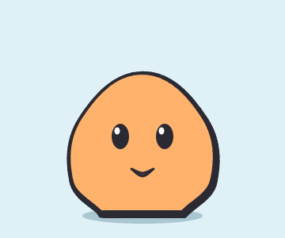

<p align="center"></p>

# Guia da linguagem Weasel

Este guia ensina a linguagem do Weasel do começo, com um exemplo em cada passo e a imagem que ele gera logo abaixo. Se o [README](../../README.md) é a lista de tudo o que existe, este guia é o **porquê** e o **como**: o que cada coisa faz, em que ordem aprender e onde estão as armadilhas.



## Capítulos

| | Capítulo | O que você aprende |
|---|---|---|
| 1 | [Primeiros passos](01-primeiros-passos.md) | a ideia, as coordenadas (y para baixo!), o formato de uma linha, como ler os erros e como rodar os exemplos |
| 2 | [Formas](02-formas.md) | elipse, retângulo, formas com pontos (lisos, cantos e alças), traços, linhas, texto, contornos e desenhar por cima de uma imagem guia |
| 3 | [Cores e estilos](03-cores.md) | cores com transparência, a `palette`, variantes (de cor e de peças), gradientes e hachuras |
| 4 | [Camadas, recortes e acabamento](04-camadas.md) | `layer`, a ordem de pintura, recortar por dentro e por fora, contorno por cima, buracos e o estilo do desenho inteiro |
| 5 | [Contas, componentes e arquivos](05-componentes.md) | `let` e `{contas}`, `repeat` e `rand()`, componentes com `def`/`use`, espelho e `include` |
| 6 | [Ossos](06-ossos.md) | o que é um osso, o pivô, pai e filho, movimentos automáticos, molas, tecido, pernas com IK, formas que dobram (`bones=`), pontos presos a um osso (`@osso`, e a ferramenta Prender do editor), IK nos ossos (`ik`) e caminhos (`path=`) |
| 7 | [Animação](07-animacao.md) | `anim` e `key`, como os quadros do meio são calculados (`ease`), loop, animar cores e formas, desenhar aos poucos, morph, animações combinadas, posar com o mouse e eventos |
| 8 | [Luz, efeitos e partículas](08-luz-efeitos.md) | lâmpadas, holofotes, sol e lua, brilho, sombra no chão, efeitos de camada, rastro e partículas |
| 9 | [Jogo e Godot](09-jogo-godot.md) | caixas de colisão, golpe e dano por quadro, pontos de encaixe, andar sem os pés escorregarem, a cena pronta do Godot, o esqueleto de verdade, direções, tileset e sprite sheet |
| 10 | [Filme](10-filme.md) | atores, planos e transições, câmera, mudanças no tempo, expressões, marcadores, caminhos, profundidade, som, legendas e lip sync |
| 11 | [Profundidade (2.5D)](11-profundidade.md) | girar formas em 3D, verso e espessura, a cabeça que olha para os lados, chão em perspectiva, mapa isométrico, lente e névoa no filme |
| 12 | [Referência rápida](12-referencia.md) | todas as instruções e atributos, com os valores padrão |
| 13 | [Problemas comuns](13-problemas.md) | o que costuma dar errado e como resolver |
| 14 | [Estilos de arte](14-estilos.md) | a linha `art`: o mesmo desenho em pixel art (paletas, pontilhado, contorno, folha pequena para o Godot), em letras (ASCII, também em `.txt`), em cel shading, gravura, xilogravura, retícula, HQ (moderna, antiga e tira de jornal), mangá, risografia, estêncil e silhueta (com a textura presa à forma), em esboço, marcador, lápis de cor, giz de cera e giz no quadro (que fervem), em aquarela, só no contorno e em neon, em recorte de papel e em massinha (peças com sombra), em vitral e em bordado, e o estilo no filme, na cena, no plano ou num ator |

**Por onde começar:** leia os capítulos 1 a 4 em ordem; eles são a base de tudo. Depois, os capítulos 6 e 7 (ossos e animação) são os mais importantes para personagens. O resto pode ser lido conforme a necessidade.

## Como testar os exemplos

Todo exemplo deste guia é um desenho completo: copie, cole e rode.

- **No editor web:** abra o `index.html`, crie um arquivo novo na barra acima do código e cole. O desenho aparece à direita, e as animações tocam no player.
- **Na linha de comando:** salve como `teste.weasel` e rode `node cli/weasel.js teste.weasel` (ou `-a nome_da_anim -o teste.gif` para uma animação).

Os exemplos que usam outros arquivos (`include "cavaleiro.weasel"`, `actor … "fantasma.weasel"`) esperam estar na pasta [`exemplos/`](../../exemplos/), junto com os personagens de exemplo.

## Como este guia é feito

As imagens não foram desenhadas à mão: cada uma é a saída do exemplo que está logo acima dela, gerada pela linha de comando. Um comentário invisível antes do bloco de código diz o nome da imagem e as opções:

```
<!-- gerar: img/07_bola.gif -a quica -->
```

Para gerar tudo de novo (depois de mudar um exemplo ou o próprio Weasel):

```bash
npm run docs
```

O `npm test` também lê todos os exemplos do guia e falha se algum deles der erro ou aviso, para o guia não ficar desatualizado em relação à linguagem.
