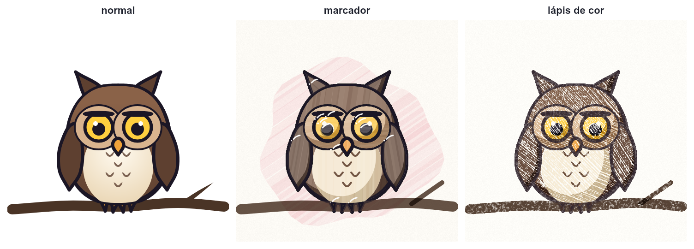
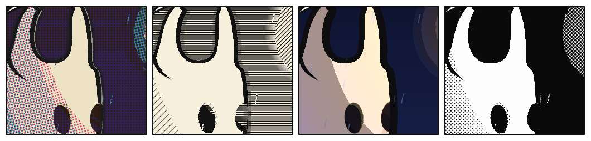
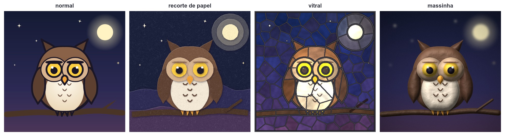

# Outros estilos: pixel art, ASCII, esboço, marcador, HQ e mais

**Situação:** análise e protótipos feitos em 12 e 13/11/2026, fora do Weasel. Em 14/11/2026 você respondeu as perguntas (ver [Decisões](#decisões-de-14112026)) e deu o "pode fazer" da fase 1. A fase 1 foi feita na 1.30.0 (ver [Como a fase 1 ficou](#como-a-fase-1-ficou-1300)). A fase 2 virou duas versões (ver [Decisões da fase 2](#decisões-da-fase-2-14112026)): as bases saíram na 1.31.0 (ver [Como as bases de tom ficaram](#como-as-bases-de-tom-ficaram-1310)) e as combinações na 1.32.0 (ver [Como as combinações de tom ficaram](#como-as-combinações-de-tom-ficaram-1320)). A fase 4 também virou duas versões (ver [Decisões da fase 4](#decisões-da-fase-4-14112026)): `sketch`, `marker`, `pencil`, `lines` e `neon` saíram na 1.33.0 (ver [Como os estilos de traço ficaram](#como-os-estilos-de-traço-ficaram-1330)), e `crayon`, `chalk` e `watercolor` na 1.34.0 (ver [Decisões da 1.34.0](#decisões-da-1340-14112026) e [Como o giz e a aquarela ficaram](#como-o-giz-e-a-aquarela-ficaram-1340)). A fase 5 também virou duas versões (ver [Decisões da fase 5](#decisões-da-fase-5-14112026)): `cutout` e `clay` saíram na 1.35.0 (ver [Como o recorte e a massinha ficaram](#como-o-recorte-e-a-massinha-ficaram-1350)), e `glass` e `embroidery` na 1.36.0 (ver [Decisões da 1.36.0](#decisões-da-1360-14112026) e [Como o vitral e o bordado ficaram](#como-o-vitral-e-o-bordado-ficaram-1360)); falta a fase 6 (1.37.0).

**Origem:** quatro perguntas suas:
- dá para gerar pixel art, ASCII ou outro estilo a partir do Weasel, sem modelar pixel por pixel, mesmo que não fique 100% perfeito?
- dá para um estilo que pareça desenhado à mão, com marcador ou lápis de cor? (A imagem de referência era de marcador, com caneta preta fina no contorno e caneta gel branca nos brilhos.)
- dá para um estilo de HQ, colorido e preto e branco, antigo e moderno?
- que outros estilos dá para gerar? (Da resposta saíram os protótipos de recorte de papel, vitral e massinha.)

**Resposta curta:** sim. O Weasel guarda o desenho como formas, e não como uma imagem pronta, então ele pode pintar a mesma cena de outros jeitos.

## Decisões de 14/11/2026

**Quais estilos:** todos, menos os três de [Não recomendo](#não-recomendo).

**A instrução:** uma linha própria, `art`, na parte de cima do arquivo, como o `finish`. A primeira palavra é o estilo, e depois vêm as opções dele. Só nomes em inglês:

```
art pixel size=8 palette=gameboy dither=bayer outline small
art comic old bw
art cutout boil=0
```

- Um `art` por arquivo de personagem. Sem `art`, nada muda.
- O `finish` continua como está e funciona junto. O `finish pixel=` continua sendo o pixelado de hoje; o pixel art nítido é o `art pixel`.
- `art none` desliga o estilo (útil no filme).

**Os nomes:**

| Estilo | Nome | Opções próprias |
|---|---|---|
| Pixel art | `pixel` | `size=`, `palette=own\|gameboy\|nes\|pico8\|mono`, `dither=bayer`, `outline`, `small` |
| ASCII | `ascii` | `size=6,12`, `chars=`, `color`; sai também em `.txt` |
| Retícula | `halftone` | `size=`, `angle=`, `color` |
| Ponto-cruz, mosaico, tricô | `stitch`, `mosaic`, `knit` | `size=`; o mosaico tem `grout=` |
| Esboço, marcador, lápis de cor | `sketch`, `marker`, `pencil` | `paper=` |
| Giz de cera, giz no quadro, aquarela | `crayon`, `chalk`, `watercolor` | `paper=` |
| Só contorno, neon | `lines`, `neon` | `w=`, `c=` |
| Recorte de papel | `cutout` | |
| Massinha, vitral, bordado | `clay`, `glass`, `embroidery` | o vitral tem `size=` e `lead=` |
| Cel shading | `toon` | `steps=` |
| Gravura, xilogravura | `engraving`, `woodcut` | `gap=` |
| HQ | `comic` (moderna colorida), `comic old`, `comic old bw` (`bw` = *black and white*), `manga` | `size=` |
| Risografia, estêncil, silhueta | `riso`, `stencil`, `silhouette` | `inks=`, `tones=`, `c=` |

**Opções de todos os estilos:**
- `boil=2` redesenha a textura a cada 2 quadros (a fervura); `boil=0` deixa a textura presa à forma. Cada estilo tem o seu padrão.
- `seed=` sorteia outra versão do mesmo desenho.

**Pixel art no jogo:** `small` faz só a sprite sheet e o Godot saírem no tamanho pequeno de verdade. O vídeo e o GIF saem sempre no tamanho do `canvas`, com o pixel nítido.

**Efeitos de tela:** no `finish`, como o `bloom=`: `oldfilm=`, `vhs=`, `crt=` e `glitch=`, de 0 a 1. Seguem a regra de hoje do `finish` (o arquivo principal; sem ele, a cena).

**No filme, quatro níveis.** O mais específico ganha: ator, depois plano, depois cena, depois filme.

| Onde vale | Como escrever |
|---|---|
| O filme todo | `art` no começo do arquivo do filme |
| Uma cena | `art` no começo do arquivo da cena |
| Um plano | `art` dentro do bloco do `shot` |
| Um personagem | `art … actor=coruja` (no começo do filme ou dentro de um `shot`) |

- O `art` do arquivo do próprio personagem vale para o jogo e as exportações dele; no filme, quem decide é o filme.
- Quando o quadro todo tem o mesmo estilo, ele é aplicado de uma vez (uma grade só no pixel art e no ASCII). Um personagem com outro estilo é desenhado sozinho e encaixado na ordem de profundidade de sempre.

**No editor:** o estilo aparece, como já aparecem o `pixel=` e o `bloom=`, e as alças continuam nos pontos do desenho. Uma chave "Estilo" liga e desliga. Os estilos pesados mostram o desenho normal enquanto você arrasta.

**Fases** (cada uma é uma versão):
1. **1.30.0:** a linha `art`, os quatro níveis do filme, a chave Estilo, as exportações, `boil=` e `seed=`, e os estilos `pixel` e `ascii`.
2. **1.31.0, tom (as bases):** `toon`, `halftone`, `engraving`, `stencil` e `silhouette`.
3. **1.32.0, tom (as combinações):** `woodcut`, `comic`, `comic old`, `comic old bw`, `manga` e `riso`.
4. **1.33.0, traço (o passe forma por forma):** `sketch`, `marker`, `pencil`, `lines` e `neon`. **1.34.0, traço (os outros):** `crayon`, `chalk` e `watercolor`.
5. **1.35.0, peças:** `cutout` e `clay`. **1.36.0, peças (as outras):** `glass` e `embroidery`.
6. **1.37.0, o resto:** `stitch`, `mosaic`, `knit` e os efeitos de tela.

### Decisões da fase 2 (14/11/2026)

- **Duas versões:** a fase de tom foi dividida em duas (acima). As bases saem antes, para você ver e ajustar antes das HQs serem montadas em cima delas.
- **`toon` sem luz:** cada forma ganha uma faixa de sombra com borda nítida no lado longe do `light=` do `canvas` (a mesma direção do contorno). Com `light` ou `ambient`, a luz também vira degraus, como no [protótipo](#cel-shading).
- **Hachura presa à forma:** na gravura e na xilogravura, a hachura de cada forma gira e anda junto com o osso dela. `boil=2` sorteia de novo a cada 2 quadros. A retícula de pontos (`comic`, `manga`, `halftone`) fica presa na tela por padrão, como na impressão: `boil=screen`.
- **Contraste:** a opção `levels=0.05,0.7` diz a claridade que vira preto e a que vira branco (padrão `0,1`), como os Níveis de um editor de imagem. Vale nos estilos que escolhem papel, hachura ou preto pela claridade. Não há ajuste automático, para nada piscar no filme.

### Decisões da 1.32.0 (14/11/2026)

- **A sombra sem luz nas HQs:** `comic`, `comic old`, `comic old bw` e `manga` ganham a faixa de sombra do `toon` (`shadow=`, padrão 0.3; `shadow=0` tira). Com luz, a luz também vira degraus.
- **Mangá:** a retícula vem em poucos tons fixos (`tones=3`), como as folhas coladas à mão, e não com o ponto seguindo o tom.
- **Risografia:** as tintas viram grão (pontinhos soltos sorteados), e não pontos em grade.
- **Registro torto:** a opção `shift=` (padrão 1.5 unidades, na direção sorteada pelo `seed=`; `shift=0` deixa no lugar), na `comic old` e na `riso`.

### Decisões da fase 4 (14/11/2026)

- **Duas versões:** a fase de traço foi dividida em duas (acima). A 1.33.0 traz o passe que pinta forma por forma e os cinco estilos que só precisam dele; a 1.34.0, os que pedem textura de papel e tinta molhada.
- **A luz entra por cima:** o estilo pinta o desenho sem luz; com `light` na cena, a luz vem depois, pela comparação entre o desenho com luz e sem luz.
- **Ferve:** `boil=2` é o padrão do `sketch`, do `marker` e do `pencil`, como o desenho à mão animado quadro a quadro.
- **O fundo no estilo:** o fundo do `canvas` é pintado no estilo (as passadas do marcador, o lápis); com `bg=none`, o papel aparece.
- **Detalhes:** o `marker` tem os brilhos de caneta gel, mas não a mancha rosa do protótipo; o `lines` e o `neon` também têm `paper=` (e `boil=` e `seed=` avisam, porque não há textura); os textos e as partículas saem como sempre.

### Decisões da 1.34.0 (14/11/2026)

- **Giz no quadro (`chalk`):** cada forma vira giz da cor dela, mais clara, e mais cheio onde a cor é mais clara; as cores escuras ficam quase só o quadro, com o contorno em giz branco. O quadro é verde-escuro por padrão; `paper=` muda.
- **Giz de cera (`crayon`):** passadas de vai-e-vem, numa direção sorteada para cada forma, presa a ela (anda e gira com o osso).
- **Aquarela (`watercolor`):** o contorno fica como uma linha fina de caneta, um pouco irregular, por cima ("caneta e aguada"), e a mancha de cor vaza um pouco para fora da linha.
- **Ferve:** o `crayon` e o `chalk` fervem a cada 2 quadros (`boil=2`); a `watercolor` fica parada (`boil=0`).

### Decisões da fase 5 (14/11/2026)

- **Duas versões:** a fase de peças foi dividida em duas (acima). A 1.35.0 traz o `cutout` e o `clay`; a 1.36.0, o `glass` e o `embroidery`. O `stitch`, o `mosaic`, o `knit` e os efeitos de tela passam para a 1.37.0.
- **O contorno no recorte (`cutout`):** vira um papel escuro, da cor da `ink`, um pouco maior, por baixo de cada peça; a cor dele aparece em volta, como uma borda.
- **Massinha (`clay`):** parada (`boil=0`), porque as peças são as mesmas de um quadro para o outro; `boil=2` remexe.
- **Bordado (`embroidery`, para a 1.36.0):** à mão, no linho. O fundo vira linho com a trama aparecendo (`paper=` muda a cor); cada forma em ponto cheio (satin) na direção dela, com o brilho da linha, e em fileiras desencontradas nas formas grandes; o contorno vira um pesponto (backstitch) da cor da `ink`.
- **O contorno na massinha:** não foi perguntado. Ficou como no recorte: uma tira de massinha da cor da `ink`, por baixo de cada peça. Dá para mudar (por exemplo, um sulco riscado na massinha, sem cor própria).

### Decisões da 1.36.0 (14/11/2026)

- **O fundo no vitral:** vira vidro também, cortado em pedaços como as formas; um degradê vira degraus de vidro. Sem fundo (`bg=none`), fica o papel.
- **A moldura:** só com a opção `frame` (`art glass frame`): um chumbo mais grosso em volta do canvas.
- **O chumbo:** igual em todas as formas, cinza-escuro com um brilho no meio. É grosso entre formas diferentes e fino (a metade) entre os pedaços da mesma forma; `lead=` muda a largura. O contorno (`ink`) só vira o chumbo grosso: a cor e a largura dele não contam.
- **Os traços no bordado:** o fino vira ponto haste, na cor dele; o largo vira ponto cheio, atravessado.
- **O fundo no bordado:** não foi perguntado. Com fundo no canvas, a trama do linho fica por cima da cor do fundo (um linho tingido); sem fundo, o linho é da cor do `paper=` (`#e6dccb`, o linho cru). Dá para mudar (por exemplo, o linho sempre cru, sem a cor do fundo).

## Como a fase 1 ficou (1.30.0)

O que está no [capítulo 14 do guia](../guia/14-estilos.md), mais as escolhas feitas no caminho:

- **O acabamento vem depois do estilo:** `bloom=`, `vignette=`, `grain=` e `posterize=` entram por cima da imagem pronta. Com um `art`, o `finish pixel=` não entra (o Weasel avisa).
- **`boil=` e `seed=`** já são lidos em todos os estilos, mas o `pixel` e o `ascii` não têm textura: neles, os dois só dão aviso. Servem para as fases seguintes.
- **As cores são comparadas em Lab** (o jeito que o olho vê), e não em RGB: no RGB, um azul-escuro ficava "perto" de um verde-escuro, e o céu virava morro.
- **`palette=own`:** todas as cores do desenho (palette, formas, gradientes, padrões e fundo). Num desenho sem fundo exportado opaco, o branco do fundo entra também.
- **O voto do pixel art:** cada ponto vira a cor mais parecida da paleta, e o bloco fica com a mais votada. A tinta ganha com 1/4 do bloco; "tinta" é o ponto cuja cor mais parecida, entre as cores do desenho, é a `ink` (no filme, a `ink` de cada arquivo). O bloco fica vazio quando o transparente ganha da cor mais votada.
- **O pontilhado** (`dither=bayer`, Bayer 4×4) mistura a cor do bloco com a segunda mais parecida, só onde a cor muda aos poucos (degradês e luz). Com 2 cores (`mono`), em tudo.
- **O `outline`** é 1 bloco por fora da silhueta, na cor da tinta.
- **ASCII:** a letra mede o quanto a célula se afasta do papel (Lab). O papel é o fundo do canvas (o primeiro tom, se for gradiente; branco sem fundo). Num papel escuro, as letras saem claras. Um ator em ASCII desenhado à parte usa o papel do filme como referência, mas não pinta o papel.
- **Na borda do canvas,** o bloco (ou a célula) só conta a parte de dentro.
- **`small`:** a escala vira pixels por bloco (`-s 3` = 3×3 pixels por bloco), e o recorte da folha cai na grade.
- **Godot:** `texture_filter = 1` (nearest) com qualquer `art pixel`; o normal map sai pixelado, um tom por bloco. No esqueleto de verdade, cada peça sai no estilo na pose parada, e o `--info` lembra que o pixel art perde a grade quando a peça gira.

## Como as bases de tom ficaram (1.31.0)

O que está no [capítulo 14 do guia](../guia/14-estilos.md#estilos-de-tom-toon-engraving-halftone-stencil-e-silhouette), mais as escolhas feitas no caminho. Elas são a base da 1.32.0 (`woodcut`, `comic`, `manga` e `riso`).

- **Passes:** o estilo pede o mesmo desenho de outro jeito, e o Weasel desenha de novo: sem luz (`unlit`), sem o contorno (`noInk`), com a faixa de sombra do toon (`toon`) ou com a textura presa à forma (`tex`). Sem estilo, nada disso roda: os desenhos de antes saem iguais.
- **Resolução:** os estilos de tom pintam na resolução da imagem final, de 1 a 4 pontos por unidade do desenho. Numa escala menor que 1, eles pintam a 1 ponto por unidade e reduzem com suavização (a hachura não vira borrão).
- **`toon`:** a faixa é a forma menos ela mesma empurrada na direção do `light=` do canvas, com largura `shadow=` vezes o tamanho da forma nessa direção, multiplicada por um cinza-azulado (`#a9aec6`). Formas com 90% ou mais da largura ou da altura do canvas, camadas `unlit` e guias ficam sem faixa. Com luz, a razão entre o desenho com luz e sem luz é arredondada em degraus de log2 de tamanho `2/(steps-1)`; onde o desenho sem luz é muito escuro (claridade abaixo de 0,06), fica o desenho com luz.
- **`engraving`:** a hachura vem do tom do desenho sem contorno; as quatro famílias de linhas (45°, −45°, horizontal e 45° no meio) entram com o escuro, e acima de 0,85 o preto chapado entra. O contorno é medido pela diferença entre o desenho com e sem `ink`, e sai preto. Papel `#f6f2ea`, tinta `#1c1a17`.
- **`halftone`:** a grade de cada retícula é feita com números inteiros, para se repetir sem emenda: o ângulo e o tamanho ficam bem perto dos pedidos. O quase branco (até 4%) fica papel e o quase preto (de 88% em diante) fica chapado, como a impressão faz. A separação de cores é a simples: o preto tira o que as três cores têm em comum.
- **`stencil`:** o ruído é suave (um valor por unidade, misturado entre vizinhos) em dois tamanhos; ele empurra o tom para um lado ou para o outro só perto da troca de tom.
- **`silhouette`:** o desenho é feito sem luz (o halo e a sombra projetada não viram silhueta) e pintado de uma cor só; o fundo fica.
- **A textura presa à forma:** o passe `tex` pinta cada forma com uma textura que guarda o cosseno e o seno de uma volta a cada 128 unidades (um passe para u, outro para v), girada e movida com a forma (pelo osso, no centro da caixa dela) e na escala da tela. A primeira tentativa guardava direto o cosseno da hachura, mas a suavização do canvas tirava contraste (erro médio de 12 em 255); a volta lenta não sofre com isso, e as contas da hachura, dos pontos e do ruído são feitas depois, exatas. Na pose parada, a textura presa é igual à da tela (só pontos soltos na borda das formas mudam).
- **Tempo** (Cavaleiro, 800×640, escala 1): toon sem luz quase nada; engraving uns 60 ms; halftone uns 40 ms (color, uns 110); stencil uns 50 ms. Um quadro Full HD do filme de exemplo leva de 0,3 s (toon) a 1 s (engraving).

## Como as combinações de tom ficaram (1.32.0)

O que está no [capítulo 14 do guia](../guia/14-estilos.md#as-combinações-de-tom-woodcut-comic-manga-e-riso), mais as escolhas feitas no caminho.

- **Os nomes:** `old` e `bw` são opções do `comic`. `comic bw` sem o `old` avisa e vale como `comic old bw` (a única HQ preto e branco). O `boil=` padrão é `screen` na `comic`, na `comic old`, no `manga` e na `riso` (impressão) e 0 na `comic old bw` e na `woodcut` (o traço do desenhista e o corte da madeira).
- **`woodcut`:** um sulco branco deitado na forma por `gap=` (8), entortado por um ruído largo (um valor a cada 16 unidades) e com a borda engrossada e afinada por um fino (a cada 4). A largura do sulco cresce com a luz; no escuro, o ruído some aos poucos, para o preto ficar chapado.
- **`comic`:** o `toon` (a faixa e a luz em 3 degraus), com a saturação 25% mais forte. A retícula entra onde o ponto ficou mais escuro que a cor chapada (sem luz e sem faixa): de 15% mais escuro em diante, até 50% de cobertura.
- **`comic old`:** a cena é clareada 12% antes da tabela de 64 cores (a cor mais perto em Lab, guardada para cada cor que aparece). O preto chapado entra abaixo de 13% de claridade (completo em 8%). A cor sai do lugar em pontos inteiros da imagem de trabalho; o preto e o contorno ficam no lugar. Papel-jornal `#f0e6cc`.
- **`comic old bw`:** hachura a 45° de 25% a 55% de escuro, linhas deitadas que engrossam de 55% até o preto chapado em 85%; a hachura some enquanto as linhas entram.
- **`manga`:** papel abaixo de 18% de escuro, preto chapado de 82% a 85%; entre os dois, `tones=` faixas iguais, com 15% a 65% de cobertura.
- **`riso`:** a mistura das tintas é calculada no modelo da impressão (em cada canal, o papel vezes `1 − x·(1 − tinta)` de cada tinta), uma tinta por vez (com as outras paradas, a conta é exata), e guardada para cada cor. O quase papel (até 8% de tinta) fica papel. O grão é um ruído suave com um valor por célula de `size=`; uma tabela corrige o limiar para a cobertura sair certa. Cada tinta sai do lugar numa direção (a do `seed=` mais 1/3 de volta para cada tinta).
- **Peças comuns:** a retícula de números inteiros, o ponto com o quase branco e o quase preto, a luz em degraus e o contorno medido pela diferença com e sem `ink` viraram funções da 1.31.0 que todos usam; as saídas da 1.31.0 continuam iguais.
- **Tempo** (Cavaleiro, 800×640, escala 1): `comic` uns 35 ms; `manga`, `comic old bw` e `comic old` de 50 a 70 ms; `woodcut` uns 80 ms; `riso` de 70 a 110 ms. A noite (com luzes) leva de 140 a 230 ms.

## Como os estilos de traço ficaram (1.33.0)

O que está no [capítulo 14 do guia](../guia/14-estilos.md#os-estilos-de-traço), mais as escolhas feitas no caminho.

- **O passe `stroke`:** o estilo recebe cada forma fechada (o preenchimento, o contorno e o contorno de cada buraco) e cada traço aberto, na ordem do desenho, com os recortes das camadas, e pinta do jeito dele. Ele recebe o caminho, os pontos, a caixa, as cores prontas, o osso (para a textura andar com a forma) e um número da forma (para o sorteio). As guias e as formas desenhando aos poucos (`draw=`) saem como sempre.
- **O brilho do `emit=`** é feito como uma sombra colorida; no passe `stroke`, ele sai uma vez só, antes do estilo (senão cada passada do estilo somaria o brilho). No `lines`, sai sem ele.
- **A luz por cima:** onde a luz escurece (o desenho com luz mais escuro que sem luz, canal a canal), o ponto é multiplicado pela razão; onde clareia, ele anda para o branco na mesma proporção. A primeira tentativa multiplicava sempre, e o brilho da lanterna num céu escuro estourava num disco amarelo.
- **A grossura** dos traços segue o tamanho do canvas (1 num canvas de 500 de largura ou altura, de 0,4 a 4).
- **`sketch`:** a cor sai de 1 a 2 unidades do lugar, com o papel por cima a 28%; o fundo a 80%. Hachura a 45° em traços curtos onde a cor é escura (abaixo de 50% de claridade) e na faixa de sombra. O contorno: duas passadas tremidas (`#2b2a30`, ou a `ink` da forma quando ela é escura), começando num ponto sorteado e passando 7% do fim.
- **`marker`:** a cor lisa a 60% e duas camadas de passadas no comprimento da caixa parada da forma, por cima (sem multiplicar, para o escuro não virar preto); a sombra é a cor multiplicada a 40%. O fundo: a cor a 72% e passadas largas da cor dele.
- **`pencil`:** em dois passes. No primeiro, a cor lisa (e a faixa de sombra multiplicada); depois, ponto a ponto, ela vira hachura: um azulejo de 128 unidades guarda o quanto cada ponto está perto do meio de um traço, em duas famílias (a −60° e a cruzada, a 30°). As linhas têm direção inteira no azulejo, então ele se repete sem emenda; com a direção sem divisor comum, as linhas viram uma linha só que dá voltas no azulejo, cortada em traços de tamanhos diferentes (com o mesmo tamanho, os buracos se alinhavam e faziam faixas). O azulejo é preso a cada forma pelo passe `tex`. A força (o canal que mais se afasta do papel) alarga o traço e fecha a hachura; o grão do papel fica parado na tela. No segundo passe, por cima e sem hachura, os contornos e os traços finos (cada forma apaga o que ficou atrás dela).
- **Por que o `pencil` não risca traço por traço:** a primeira versão riscava cada linha da hachura no canvas, como o `sketch`. Ficava bonita num canvas de 800, mas num de 1920 os traços ficavam grossos e a conta passava de meio segundo por quadro. Riscar muitas linhas num caminho só era ainda pior (10 vezes mais lento que uma por vez).
- **`lines`:** o papel em cada forma e o contorno por cima; o traço com mais de 3 vezes a espessura vira o contorno dele (o corpo crescido em 8 direções, e o corpo de novo em papel por cima); até 1,2 vez, fica como é; no meio, uma linha só no centro.
- **`neon`:** a cor de cada forma (a do preenchimento ou a da `ink`) com a saturação no mínimo 0,75 e a claridade entre 0,58 e 0,68; o miolo a 70% do caminho até o branco; o brilho é o desenho borrado (7 e 2,5 unidades) somado por cima.
- **Tempo** (escala 1): no Cavaleiro (800×640), de 4 a 22 ms (`pencil`, uns 45); na noite (com luzes), de 30 a 90 ms; no cenário (1920×1080), de 5 a 110 ms.

## Como o giz e a aquarela ficaram (1.34.0)

O que está no [capítulo 14 do guia](../guia/14-estilos.md#giz-de-cera-giz-e-aquarela-art-crayon-art-chalk-e-art-watercolor), mais as escolhas feitas no caminho.

- **Como o `pencil`:** os três pintam em dois passes. No primeiro, a cor lisa (e a faixa de sombra); depois, ponto a ponto, ela vira a textura do estilo; no segundo passe, por cima, os contornos e os traços finos.
- **As passadas** (`crayon` e `chalk`) usam o azulejo de hachura do `pencil`, com traços mais largos e mais compridos, em duas famílias quase na mesma direção (a ida e a volta). O azulejo ganhou um terceiro canal: os riscos secos, um ruído comprido ao longo de cada traço (onde o giz pulou). A direção de cada forma vem de um giro novo no passe `tex` (`turn`), sorteado pelo número da forma.
- **`crayon`:** a força da cor (o quanto ela se afasta do papel) alarga as passadas; o grão do papel, parado na tela, deixa pontinhos claros, mais onde a pressão é pouca; onde a pressão é pouca, um véu leve de cera (senão a cor clara vira uma chuva de riscos). Na borda de cada forma, uma faixa da cor multiplicada por dentro (a cera junta). O contorno: a linha grossa e tremida, com o grão.
- **`chalk`:** a quantidade de giz vem da claridade (o maior canal e a claridade, juntos), descontada a do quadro; a cor é a da forma 40% mais perto do branco. Uma imagem da cobertura das formas separa o fundo: nas formas, as passadas; no fundo, só pó em nuvens. O quadro tem o resto de giz apagado (nuvens bem leves). A primeira versão passava o fundo claro do Cavaleiro pelo mesmo giz das formas, e o quadro sumia sob listras.
- **`watercolor`:** a cor multiplicada sobre o papel a 85%; na borda, do lado de fora, a aguada que vazou (uma faixa tremida a 70%, com a borda dura) e, do lado de dentro, a tinta que juntou (mais escura); a sombra é uma segunda aguada a 40%. A mancha desigual vem de um azulejo de ruído (preso à forma) somado a um ruído grande, parado na tela (com o azulejo sozinho, a repetição aparecia num céu grande). A granulação e o papel de aquarela ficam parados na tela.
- **`bg=none`:** na 1.33.0, o `sketch`, o `marker` e o `pencil` pintavam o fundo branco da imagem quando o canvas não tinha `bg` (numa imagem; no filme, o papel já aparecia). Agora o papel aparece, como o guia dizia; só a referência do teste `estilo_pencil` mudou.
- **Tempo** (escala 1): no Cavaleiro (800×640), de 80 a 100 ms; no cenário (1920×1080), de 170 a 200 ms (os ruídos grandes são calculados numa grade e misturados, para não pesar ponto a ponto).

## Como o recorte e a massinha ficaram (1.35.0)

O que está no [capítulo 14 do guia](../guia/14-estilos.md#recorte-e-massinha-art-cutout-e-art-clay), mais as escolhas feitas no caminho.

- **Como o `pencil`:** os dois pintam forma por forma, no passe `stroke`, e depois ponto a ponto. As sombras das peças são a sombra do próprio canvas (`shadowBlur`), para o lado longe do `light=` do `canvas`.
- **`cutout`, a peça:** o contorno da forma refeito em cortes retos (de 1,5 a 5 unidades, conforme o tamanho da forma), com um tremido pequeno; os cantos ficam no lugar. Por baixo, com sombra, o papel escuro do contorno: a peça com um traço em volta, da largura do contorno (de 0,8 a 6 unidades para fora). Por cima, a beirada clara: a peça menos ela mesma empurrada para o lado da luz, em branco a 22%.
- **`cutout`, o degradê:** três folhas da mesma peça, em degraus do degradê, cada uma com a sua sombra. A forma que brilha (`emit=`) ganha dois anéis de papel 35% mais claro que a cor do brilho.
- **`cutout`, o fundo:** o tom do fundo em três níveis, e cada nível vira uma folha da cor média dele; a folha mais alta na tela fica atrás. A borda entre as folhas lê o tom um pouco ao lado (até 5 unidades, em ondas de 30), para ondular como papel rasgado. A primeira versão somava um ruído ao tom: num degradê lento (um céu), a borda virava ilhas e escadinhas.
- **`cutout`, o papel:** um azulejo de fibras (420 curvas curtas, claras e escuras, desenhadas também do outro lado da borda, para emendar), grão e manchas leves, preso a cada peça pelo passe `tex`; clareia e escurece a cor em até 16%.
- **`clay`, três passes:** a cor (com a sombra de contato e a tira do contorno por baixo), a altura e as peças. Na altura, cada forma é preta, com ela mesma borrada em branco por cima (recortada nela): 0,5 na borda e 1 lá dentro, numa borda redonda de 1,5 a 12 unidades. A tira do contorno e os traços são rolinhos (quatro larguras, cada uma mais alta). As covinhas de dedo são manchas escuras e rasas, sorteadas por forma, nas formas com mais de 28 unidades. Nas peças, cada forma tem uma cor sorteada (24 bits), para o volume não passar de uma peça para a outra; a mistura de duas, na borda, fica com a de um vizinho.
- **`clay`, ponto a ponto:** os caroços (um azulejo de ruído em 16, 8 e 4 unidades, maiores num canvas maior, preso à forma); a altura alisada em números, só dentro de cada peça (com os 8 bits do canvas, a luz fazia listras numa rampa lenta, como a do chão do cenário); a inclinação pela diferença de altura dos vizinhos da mesma peça; a luz do `light=` do `canvas`, difusa (de 0,6 a 1) e com um brilho leve. O fundo é desfocado 1,5 unidade, por cima dele mesmo nítido (só o desfocado deixava a beirada da imagem mais clara).
- **Tempo** (escala 1): no Cavaleiro (800×640), uns 55 ms no `cutout` e 80 no `clay`; na noite (com luzes), uns 210 ms; no cenário (1920×1080), uns 130 ms no `cutout` e 300 no `clay`.

## Como o vitral e o bordado ficaram (1.36.0)

O que está no [capítulo 14 do guia](../guia/14-estilos.md#vitral-e-bordado-art-glass-e-art-embroidery), mais as escolhas feitas no caminho.

- **Como o `clay`:** os dois pintam forma por forma, no passe `stroke`, e depois ponto a ponto, com um passe de peças: cada forma com uma cor sorteada (24 bits), para saber onde uma acaba e a outra começa. A mistura de duas, na borda, fica com a de um vizinho.
- **`glass`, o corte:** um azulejo de Voronoi (pontos sorteados numa grade de 8 por 8 pedaços, emendando nas beiradas), preso a cada forma pelo passe `tex`. Por isso o corte anda e gira com o osso sem ser calculado de novo (o problema do protótipo). Cada ponto lê do azulejo o pedaço, a distância até a divisa (o chumbo fino) e as manchas do vidro (um ruído esticado, como o do vidro soprado).
- **`glass`, as peças:** uma forma menor que 1,2 pedaço fica inteira; menor que 3 chumbos, vira conta (sem chumbo em volta e 12% mais clara). O chumbo grosso vem da distância até a divisa entre duas peças (uma distância em dois passes, com pesos 1 e √2).
- **`glass`, a cor:** a média do pedaço, só com os pontos que são mesmo da peça (para a borda misturada não sujar a cor), com a saturação ×1,35 e, sorteados, ±8% de brilho e ±3% em cada canal. O vidro vai de 10% mais claro em cima a 10% mais escuro embaixo, tem manchas de ±11% e escurece até 16% perto do chumbo.
- **`glass`, o brilho:** as partes claras vão para um mapa, borrado em 5 unidades e somado por cima. A força depende do tom médio da cena: forte numa cena escura, nenhuma numa clara (na primeira versão, tudo brilhava no fundo claro do Cavaleiro).
- **`glass`, o chumbo:** o padrão é 4 unidades (0,8% do lado maior do canvas), e o fino é a metade. A cor vai de um chumbo quase preto na beirada a um cinza claro no meio (o brilho é estreito). A primeira versão, com 3 unidades e um cinza mais claro, parecia um desenho, e não chumbo.
- **`glass`, os traços:** os mais finos que 2,5 chumbos viram grisalha (a cor do traço a 45%, quase opaca), por cima do vidro; os mais largos viram vidro.
- **`embroidery`, o ponto cheio:** um azulejo de linhas (cada fio com o seu brilho e uma torção leve, os pontos de uns 13 unidades em fileiras desencontradas), preso à forma e girado na direção dos pontos dela: pelo lado mais curto, com até 20° sorteados para um lado ou para o outro. O brilho é o seno do ângulo entre a direção dos pontos e a luz do canvas. Uma sombra leve embaixo de cada forma dá a altura do bordado.
- **`embroidery`, o linho:** um azulejo de trama simples (os fios passam por cima e por baixo, com engrossamentos), parado na tela e multiplicado pela cor do fundo. A primeira versão parecia uma grade e serrilhava: a trama ficou mais leve, e o fio tem um tamanho mínimo na tela.
- **`embroidery`, o contorno e os traços:** o pesponto segue o contorno em pontos de 2,6 unidades, com um vão e um tremido pequenos. Cada ponto (também os do ponto haste) é uma linha em três passadas: a sombra, a cor e um brilho do lado da luz. Os traços com menos de 6 unidades viram ponto haste; os outros, ponto cheio atravessado. O `dash=` deixa os vãos sem ponto.
- **Mais rápido em todos os estilos com textura:** o `texFill` (o passe `tex`) agora faz o padrão de cada azulejo uma vez só, e não a cada forma. No vitral do cenário, o quadro foi de 540 para 180 ms. As referências dos testes não mudaram.
- **Tempo** (escala 1): no Cavaleiro, uns 50 a 80 ms no `glass` e 45 no `embroidery`; na noite, uns 180 ms no `glass` e de 160 a 250 no `embroidery`; no cenário, uns 180 ms nos dois.

## O que já existe

Tudo no `finish` ([capítulo 4](../guia/04-camadas.md#acabamento-finish)):
- `pixel=8`: desenha 8 vezes menor e aumenta sem suavizar.
- `posterize=4`: poucas cores; `posterize=palette`: só as cores da `palette`.
- `flat`: tira todos os contornos.
- `bloom=`, `vignette=` e `grain=`: brilho, bordas escuras e granulado.
- Fora do `finish`, `pattern hatch` e `pattern dots` fazem hachura e pontilhado (exemplo `gravura.weasel`), mas você escolhe à mão onde vai cada padrão.

## O teste com o Cavaleiro


- **Hoje (esquerda):** o desenho pequeno é feito com suavização, então as bordas viram cores misturadas.
  - O `posterize=palette` troca essas misturas pela cor mais parecida da palette. Por isso aparecem pontos azuis da capa em volta da máscara.
  - O fundo mudou de cor, porque a cor dele não está na palette.
- **Protótipo (direita), feito fora do Weasel:**
  1. desenha no tamanho normal (800×640);
  2. troca cada ponto pela cor mais parecida da palette (a cor do fundo entra na lista);
  3. em cada bloco de 8×8, fica a cor que **mais aparece**;
  4. o contorno ganha quando cobre um quarto do bloco, para não sumir.
- **Resultado:** nenhuma cor inventada, contorno contínuo, fundo certo.

## Protótipos

Feitos fora do Weasel, num script que carrega o motor dele (como a linha de comando faz) e usa as formas, os ossos e a luz da cena. Mostram o resultado esperado; a versão de verdade corrigiria os defeitos anotados.

### Esboço com a linha fervendo


- **Como foi feito:**
  1. a cor vem do desenho sem contorno (`finish flat`), mais clara e deslocada uns pixels, como marcador;
  2. cada forma é passada duas vezes a lápis, com um tremido suave (ondas ao longo da linha), começando num ponto qualquer e passando um pouco do fim;
  3. as partes escuras ganham hachura a lápis;
  4. o tremido, o deslocamento da cor e a hachura mudam a cada 2 quadros: é a fervura.
- **Defeito:** o lápis é desenhado por cima de todas as cores, então aparecem linhas que no desenho normal ficam escondidas atrás de outra forma (os laços na capa). Na versão de verdade, cada forma pintaria a cor e o lápis na ordem certa.
- **Peso:** com o granulado do papel, o GIF passa de 1,7 MB; sem ele (este aqui), 0,5 MB.

### Cel shading


- **Como foi feito:**
  1. desenha a cena duas vezes: com a luz e sem a luz;
  2. a divisão das duas dá quanto de luz cada ponto recebeu, e de que cor;
  3. essa quantidade vai para o degrau mais perto (0.32, 0.62, 1, 1.35, 2.1 e 3.3 vezes);
  4. o contorno e o que é quase preto ficam como estão.
- **Resultado:** a máscara ficou em dois tons, o halo do lampião virou anéis e a sombra no chão ganhou borda definida.
- **Limite:** depende de `light` e `ambient`. Um desenho sem luz, como o Cavaleiro sozinho, não muda.

### Gravura automática


- **Como foi feito:**
  1. o quanto cada ponto é escuro escolhe a hachura: claro fica papel; depois entram linhas a 45°, a −45°, horizontais e mais linhas a 45°; quase preto vira nanquim sólido;
  2. os tons são esticados (3% mais claros e 3% mais escuros), porque a cena da noite é toda escura;
  3. o contorno vem da diferença entre o desenho com e sem contorno, e vira traço de nanquim.
- **Defeitos:**
  - as linhas vão todas na mesma direção na tela; numa gravura de verdade, elas acompanham a forma;
  - uma cena muito escura fica pesada no topo; precisaria de um controle de contraste.

### Marcador e lápis de cor



Os dois pintam **forma por forma**, na ordem do desenho e com os recortes das camadas. Usam a direção da luz do `canvas` (`light=`, a mesma do `weight=`). O céu da coruja foi tirado, e o fundo virou papel.

- **Marcador, como foi feito:**
  1. antes de cada cor, o papel fica em branco onde ela vai. É o que o artista faz, porque um marcador claro não cobre um escuro (a barriga creme sobre o corpo marrom);
  2. uma camada lisa de cor e, por cima, passadas largas na direção do comprimento da forma, com espaço e força irregulares. Onde duas se cruzam, fica mais escuro;
  3. a cor fica deslocada 1 ou 2 pixels: num lado sobra um fio de papel, no outro ela passa da linha;
  4. a sombra é uma segunda passada mais escura, do lado longe da luz: a forma menos ela mesma deslocada para a luz. Nos degradês, a cor mais escura do degradê;
  5. o contorno do próprio Weasel, em nanquim, por cima;
  6. os brilhos de caneta gel: um risquinho e um ponto branco no lado da luz das formas grandes;
  7. uma mancha rosa atrás, em passadas.
- **Lápis de cor, como foi feito:**
  1. o grão do papel é um mapa de "morrinhos"; o lápis só pinta onde a pressão vence o grão;
  2. a cor vem em hachuras finas e inclinadas, mais uma camada leve cruzada;
  3. a sombra: mais pressão e a cor mais escura, do lado longe da luz;
  4. o contorno do Weasel vira um lápis escuro, também falhado pelo grão.
- **Resultado:**
  - o lápis de cor é o mais convincente: o grão e as hachuras enganam bem de longe;
  - o marcador já parece desenho de marcador. A primeira versão tinha passadas regulares demais (parecia veludo cotelê); irregulares e mais suaves, ficou melhor.
- **Defeitos:**
  - a direção das passadas é uma regra (o comprimento da forma), e não segue o volume como faria o artista: as penas, a curva da barriga;
  - os brilhos de caneta gel caem sempre no mesmo lugar de cada forma;
  - é uma imagem parada. Animado, o desenho precisa redesenhar as passadas e o grão a cada 2 quadros (ver [No Weasel e no jogo](#no-weasel-e-no-jogo)).

### HQ antiga e moderna




As quatro partem da cena da noite (`noite.weasel`) desenhada três vezes: com luz, sem luz e sem contorno. O contorno é a diferença entre o desenho com e sem contorno, como na gravura. O balão e o recordatório foram desenhados à parte no protótipo, porque o Weasel não tem balão.

- **Antiga colorida (gibi dos anos 40 a 70), como foi feito:**
  1. o colorista antigo não pintava degradê. Para cada área, ele escolhia uma cor de uma tabela de 64, em que o ciano, o magenta e o amarelo entram com 0, 25, 50 ou 100%. O protótipo escolhe, ponto a ponto, a cor mais parecida dessa tabela, depois de clarear um pouco a cena (a tinta no jornal não chega ao escuro da tela);
  2. cada tinta é impressa em pontos (retícula), cada uma num ângulo, sobre papel-jornal amarelado;
  3. o preto vem só do contorno e das sombras mais fundas (os prédios), como o desenhista fazia;
  4. a cor sai 2 pixels fora do contorno: é o registro torto da impressão barata.
- **Antiga preto e branco (tira de jornal), como foi feito:**
  1. o mais escuro vira preto chapado (os prédios e o alto do céu);
  2. o céu um pouco mais claro vira linhas deitadas que vão afinando, um truque clássico para noite;
  3. os tons médios viram hachura em diagonal, e o personagem iluminado fica no papel.
- **Moderna colorida:** é o [cel shading](#cel-shading), com a cor um pouco mais forte e uma retícula leve no degrau mais escuro.
- **Mangá:** preto chapado no mais escuro e retícula de pontos a 45° nos tons médios. O tamanho do ponto segue o tom, e o papel é branco.
- **Resultado:**
  - o mangá foi o melhor de primeira;
  - a antiga colorida ficou com cara de gibi antigo: céu roxo-azulado chapado, prédios em preto e o halo do lampião em anéis.
- **Defeitos e cuidados:**
  - a primeira versão das antigas usou os tons esticados da gravura e saiu quase toda preta. Os limites agora usam o brilho real da cena; uma cena de dia precisaria de outros limites, ou de um controle de contraste;
  - na antiga colorida, o corpo do Cavaleiro ficou rosado, porque a luz da cena o deixa assim. Um colorista o pintaria de branco;
  - na página reduzida, as linhas do céu e os pontos formam um leve efeito de tela (*moiré*). Em tamanho real, isso some;
  - a retícula da moderna colorida quase não aparece, porque esta cena tem pouca sombra funda;
  - as imagens foram salvas sem o granulado do papel-jornal: ele quase não se vê e deixava o arquivo 50% mais pesado.

### Recorte de papel, vitral e massinha



Os três pintam **forma por forma**, como o marcador e o lápis, e usam a luz do `canvas` (`light=`). A imagem está em JPEG, porque as texturas deixavam o PNG com 1 MB.

- **Recorte de papel, como foi feito:**
  1. o contorno vira corte de tesoura: pequenas retas a cada poucos pixels, um pouco tortas, mantendo as pontas (estrelas, orelhas);
  2. cada peça tem a sua textura de papel (grão e fibras) e uma sombra macia embaixo, para o lado contrário da luz;
  3. a beirada do lado da luz fica um pouco mais clara, como a quina do papel;
  4. os traços viram tiras de papel (o galho e as penas da barriga);
  5. o degradê do céu vira três folhas, o céu e duas colinas onduladas, e o halo da lua vira dois círculos.
- **Vitral, como foi feito:**
  1. cada forma vira vidro, e as grandes são cortadas em pedaços (Voronoi), como o vidreiro faz. O céu virou dezenas de vidros;
  2. a cor de cada pedaço é a média do desenho dentro dele, mais forte e um pouco diferente da do vizinho;
  3. o vidro ganha manchas, estrias e a luz de trás, mais forte em cima. As partes claras brilham;
  4. o chumbo é grosso entre formas diferentes e fino entre pedaços da mesma forma, com um brilho no meio;
  5. os traços finos (as penas, o graveto) viram pintura escura no vidro, a grisalha dos vitrais de verdade;
  6. as formas pequenas demais (estrelas, o brilho dos olhos) viram contas de vidro sem chumbo em volta.
- **Massinha, como foi feito:**
  1. cada forma vira uma placa de massinha de borda redonda: a altura vem da distância até a borda, e a luz faz o resto, com um brilho leve;
  2. caroços suaves e duas ou três marcas de dedo nas peças grandes;
  3. cada peça faz uma sombra de contato na de baixo;
  4. o fundo e o céu ficam desfocados, como numa foto de *stop motion*, com vinheta e granulado de câmera.
- **Defeitos e cuidados:**
  - **papel:** papel não tem contorno, então o que era quase só contorno quase some. As pálpebras ficaram fininhas, e a coruja perdeu um pouco da cara de sono. Os anéis do halo saíram meio cinza; uma cor mais quente ficaria melhor;
  - **vitral:** na primeira versão, o chumbo engolia as estrelas e o graveto; daí vieram as contas e a grisalha. O corte em pedaços precisa ser calculado uma vez, com a figura parada: recalculado a cada quadro, o chumbo pularia de lugar;
  - **massinha:** a primeira versão tinha vincos retos no corpo, do jeito de medir a distância até a borda; um desfoque leve na altura resolveu. É a mais lenta das três: 0,8 s por quadro na coruja;
  - são imagens paradas. Animado, o papel precisa da textura seguindo o osso de cada peça (ver [No Weasel e no jogo](#no-weasel-e-no-jogo)).

## Os estilos, em três famílias

### 1. Grade: a imagem pronta é lida em células, e cada célula vira alguma coisa

Um único mecanismo serve para todos estes estilos. É a família mais fácil.

- **Pixel art** (recomendo começar por ele):
  - o voto por bloco do protótipo;
  - só as cores da palette;
  - pontilhado de pixel (*dither*, por exemplo o de Bayer) nos degradês e na luz, em vez de faixas;
  - um contorno de 1 pixel em volta da silhueta, feito depois de pixelar, para a espessura ser sempre igual.
- **ASCII art:** cada célula vira um caractere, conforme o quanto ela é escura (`' .:-=+*#%@'`).
  - Dá para melhorar com `/ \ | _` onde o contorno inclina, porque o Weasel sabe para onde cada linha vai.
  - Saída: um `.txt`, uma imagem ou um GIF.
  - O protótipo, com células de 6×12 pixels:

```
                  .+%@.     ##-
                :##%@%      @#*@+
               *%=*@@:     .%%--%%.
             :%*:.=@@-      =@-.=@#
            :@+..:%@+       %#...*@=
            %#...+@%        %#...-@%
           =@:...%@+        %#....%@:
           %*....%@-        %*....#@=
          =@-....*@+       .@+....*@+
          %*.....:%@-      +%:....*@*
         *@-......:+%%*++*%*-.....*@+
       :*%+%:........:---::.......-%%:
     =%*=:.-*=.....................:#@=
    =@-......-=:....................-@%
    %#..............................:@@.
    @*...............................%@-
   .@+...............................#@=
   :@=..................-##*:......-#@@=
   :@=.................:@@@@%:....:%@@@=
   :@=.................=@@@@@=....=@@@@=
   .@+.................:%@@@@:....:@@@@=
    %#..................:*##-.....:-*@@:
    *@:.........................::::=@@
   =#@#-:::............::::::::::::-#@#
  +@*=%@%##**++++++*******+++***##%@@%.
  %@*=-=++**%@%%%%%%%%%%%@@%@@@@@*=:.
   :+#@#*---%%++***##***#%@*#@@@@#
       *@+%@@%###*****##*#@##@@@@@.
       =@*@@@#*******#**#%@%#@@@@@-
       :#%%@%**++**#***###@##@@@@@=
           @#++*##***###+#@*#@@@@@=
          :@####****##*+*%@*%@@@@@:
          =@##*****#*+*#%@@#@@@@@@
          +@#***+*###%@@@@@@@@@@@*
          *@**##%@@@@@@@@@@@@@@@%.
          %@@@%*+#@@@#%@@@@%%#*=
          :-:    #@@@. *@@@:
```

- **Retícula (*halftone*) de quadrinho ou jornal:** bolinhas maiores onde é escuro. É a base das [HQs](#hq-antiga-e-moderna).
- **Ponto-cruz e mosaico:** variações divertidas do pixel art.

### 2. Traço: usa as formas, não só a imagem pronta

- **Esboço a lápis:**
  - as linhas ficam tremidas e passadas duas ou três vezes;
  - o tremido muda a cada 2 quadros, a "fervura" de linha dos desenhos animados.
  - Combina com o storyboard do seu irmão (ver [bocas por texto](bocas-por-texto.md)).
- **Marcador e lápis de cor:** pintam cada forma com passadas ou hachuras, como no [protótipo](#marcador-e-lápis-de-cor). Usam a mesma base do esboço.
- **Recorte de papel, vitral e massinha:** cada forma vira uma peça de papel, um vidro ou uma placa de massinha, como no [protótipo](#recorte-de-papel-vitral-e-massinha). O recorte de papel é o que mais combina com o Weasel, porque animação de recorte é o que ele já faz: peças presas em ossos.
- **Só contorno:** como um livro de colorir.
- **Neon:** só o contorno, colorido, com o `bloom` que já existe, num fundo escuro.

### 3. Tom: usa a luz que o Weasel já calcula

- **Cel shading (*toon*):** a luz em 2 ou 3 degraus de cor, sem degradê.
- **Gravura automática:** a sombra vira hachura sozinha. Hoje isso é feito à mão com `pattern`.
- **HQ:** a luz em degraus ou em faixas de tom, e cada faixa vira cor da tabela antiga, retícula, hachura ou preto chapado, como no [protótipo](#hq-antiga-e-moderna). Mistura esta família com a da grade.
- **Silhueta:** tudo numa cor só.

### Não recomendo

Aquarela realista, *low-poly* e pintura realista. São difíceis, e o resultado fica com cara de filtro.

A **aquarela simples**, de livro infantil, saiu desta lista em 13/11/2026: depois dos protótipos do marcador e do lápis, ela ficou possível (ver [abaixo](#outros-estilos-possíveis-ainda-sem-protótipo)).

## Outros estilos possíveis, ainda sem protótipo

Da resposta à pergunta "que outros estilos dá para gerar?" (13/11/2026). Os três que mais combinavam com o Weasel viraram [protótipo](#recorte-de-papel-vitral-e-massinha); estes ficaram só como ideia.

### Recomendados

- **Paletas retrô em cima do pixel art:** o pixel art do plano, com as cores trocadas por uma paleta pronta:
  - Game Boy (4 tons de verde);
  - NES;
  - PICO-8;
  - 1 bit: só preto e branco com pontilhado, como no Playdate ou no Mac antigo.

  É o que mais serve para jogo, e é pequeno depois que o pixel art existir.
- **Risografia ou serigrafia (pôster):** 2 ou 3 tintas de cor forte (rosa, azul-petróleo, amarelo) que se sobrepõem, com o registro torto e o grão. Aproveita quase tudo da [HQ antiga colorida](#hq-antiga-e-moderna), trocando a tabela de 64 cores por 2 ou 3 tintas.
- **Aquarela simples (de livro infantil):** pintada forma por forma, como o marcador:
  - a borda da mancha mais escura, onde a água secou;
  - a cor vazando um pouco da linha;
  - o pigmento granulado e o papel de aquarela.

### Variações do que já existe no plano

| Estilo | Vem de | Como sairia |
|---|---|---|
| Giz de cera | lápis de cor | traço mais grosso e mais falhado, com a cera acumulando nas beiradas |
| Giz no quadro-negro | lápis de cor | traço claro sobre verde-escuro; bom para cena de escola ou explicação em vídeo |
| Xilogravura ou linogravura | gravura | preto e branco forte, com sulcos brancos largos e cortes mais toscos |
| Bordado | marcador | pontos de linha na direção da forma, com o brilho do fio |
| Tricô ou crochê | a grade do pixel art | cada célula vira um "V" de ponto |
| Estêncil ou grafite | retícula e posterização | 2 ou 3 tons chapados, com respingo de spray nas bordas |

### Efeitos de tela, para filme

Não são estilos de desenho: vão por cima de qualquer estilo.
- **Filme antigo / cinema mudo:** sépia ou preto e branco, riscos, poeira, a luz piscando e a imagem tremendo um pouco. É muito fácil e combina com os filmes do YouTube.
- **VHS, CRT e *glitch*:** linhas de TV, cores separadas e falhas.
- **No jogo:** ficam melhor como um shader no Godot, por cima da tela inteira, e não na sprite sheet.

## No Weasel e no jogo

(Escrito antes das [Decisões](#decisões-de-14112026): o nome ficou `art`, e não opções do `finish`.)

- **Nada muda sozinho.** Cada estilo seria uma opção nova no `finish`, por exemplo `pixel=8 crisp` para o voto por bloco. Sem a opção, o `pixel=8` continua igual a hoje, e os arquivos existentes e os testes não mudam. O nome das opções ainda está aberto.
- **Pixel art no Godot:**
  - **O tamanho da folha:** hoje ela sai grande (800×640, em blocos de 8×8). Funciona, mas pesa 64 vezes mais e borra se o Godot aumentar a imagem com suavização. O certo é exportar no tamanho pequeno de verdade (100×80) e configurar a cena para não suavizar (`texture_filter` em *nearest*).
  - **O tremido:** quando um osso gira, os pixels tremem de um quadro para o outro. É o problema clássico de girar pixel art. O voto por bloco diminui o tremido, mas não acaba com ele.
  - **O `normal=`:** o mapa de relevo também teria de sair pixelado.
- **Cel shading e gravura no Godot:** a sprite sheet já sai no estilo. Só a luz do próprio Godot (`normal=`) continua suave, porque os degraus vêm da luz do Weasel.
- **ASCII, esboço e retícula:** servem mais para filme e storyboard. No jogo só fazem sentido se o jogo inteiro for nesse estilo, e aí a sprite sheet sai no estilo, como já acontece hoje.
- **HQ:** seria uma opção do `finish`, por exemplo `comic=antiga|antiga-pb|moderna|manga`, feita com as mesmas peças do cel shading e da gravura. No jogo, há dois caminhos:
  - **a retícula gravada na sprite sheet:** a folha precisa sair no tamanho final, porque pontos redimensionados formam *moiré*, e os pontos andam junto com o personagem;
  - **um shader no Godot** que aplica os pontos na hora, presos à tela: a sprite sheet sai só em cel shading, e nada muda no Weasel.
- **Recorte de papel, vitral e massinha no jogo:**
  - **recorte de papel:** sai direto na sprite sheet. A sombra de cada peça já vem desenhada, então ela não depende da luz do Godot;
  - **massinha:** também sai na sprite sheet, mas é a mais lenta de gerar (0,8 s por quadro na coruja), e o `normal=` teria de seguir o volume da massinha;
  - **vitral:** só se o jogo inteiro for de vitral. O corte em pedaços é feito uma vez, na pose parada, e acompanha os ossos depois.
- **Texturas na animação (esboço, marcador, lápis, gravura, retícula):** a textura pode se comportar de três jeitos.
  - **Parada no papel:** o personagem anda e a textura fica no lugar; parece que ele passa por trás de um vidro canelado. Não recomendo, com uma exceção: a retícula das HQs. Na página impressa, os pontos são da impressão e não do desenho, então ficar parada na tela é o certo.
  - **Presa à forma:** anda junto com ela; fica limpo, mas parece um adesivo. No recorte de papel, é o certo: papel de verdade anda junto com a peça.
  - **Redesenhada a cada 2 quadros,** como a fervura do esboço: parece animação desenhada à mão de verdade. Recomendo para o filme e o storyboard.
- **Peso:** o grão e as passadas comprimem mal; a sprite sheet e o GIF ficam bem mais pesados.

## Ordem sugerida

1. **Pixel art de verdade:** o voto por bloco, o pontilhado, o contorno de 1 pixel e a folha pequena para o Godot. As paletas retrô (Game Boy, NES, PICO-8, 1 bit) saem logo depois, quase de graça.
2. **ASCII:** é pequeno, porque aproveita a grade do pixel art.
3. **Esboço, marcador, lápis de cor, recorte de papel e massinha:** a mesma base (pintar forma por forma).
   - Os três primeiros e a massinha, com fervura, para o storyboard e o filme.
   - O recorte de papel, com a textura presa a cada peça, serve também para o jogo.
4. **Cel shading, gravura automática e HQ:** depois. As HQs aproveitam o cel shading (a moderna colorida) e as faixas de tom da gravura (as outras três).
5. **Vitral:** por último. Serve mais para filme (uma abertura, uma cena de igreja ou castelo) do que para personagem andando.

Os [outros estilos possíveis](#outros-estilos-possíveis-ainda-sem-protótipo) entram junto da base que eles aproveitam: a aquarela, o giz e o bordado no item 3; a risografia, a xilogravura e o estêncil no item 4. Os efeitos de tela (filme antigo, VHS) são pequenos e podem entrar a qualquer momento.

## Para decidir

As quatro perguntas daqui foram respondidas em 14/11/2026: ver [Decisões](#decisões-de-14112026).
