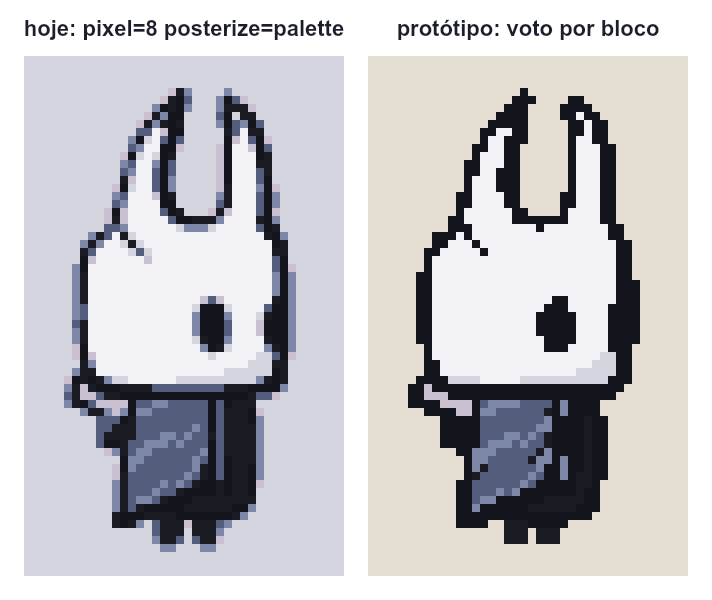
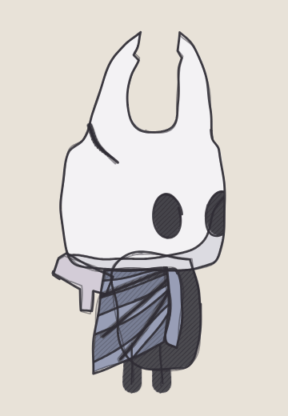
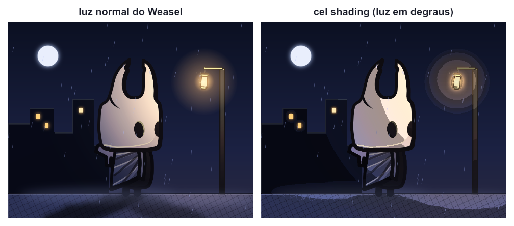
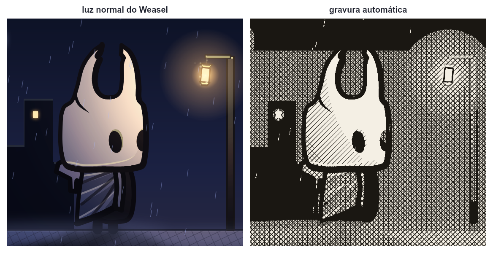
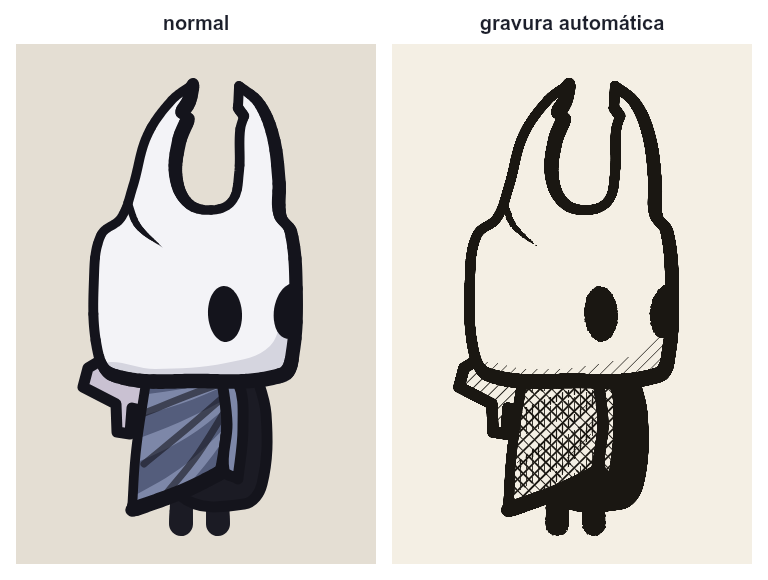

# Outros estilos: pixel art, ASCII, esboço e mais

**Situação:** análise e protótipos feitos em 12/11/2026, fora do Weasel. Nada implementado. Falta você dizer quais estilos interessam e dar o "pode fazer".

**Origem:** a sua pergunta: dá para gerar pixel art, ASCII ou outro estilo a partir do Weasel, sem modelar pixel por pixel, mesmo que não fique 100% perfeito?

**Resposta curta:** sim. O Weasel guarda o desenho como formas, e não como uma imagem pronta, então ele pode pintar a mesma cena de outros jeitos.

## O que já existe

Tudo no `finish` ([capítulo 4](../guia/04-camadas.md#acabamento-finish)):
- `pixel=8`: desenha 8 vezes menor e aumenta sem suavizar.
- `posterize=4`: poucas cores; `posterize=palette`: só as cores da `palette`.
- `flat`: tira todos os contornos.
- `bloom=`, `vignette=` e `grain=`: brilho, bordas escuras e granulado.
- Fora do `finish`, `pattern hatch` e `pattern dots` fazem hachura e pontilhado (exemplo `gravura.weasel`), mas você escolhe à mão onde vai cada padrão.

## O teste com o Cavaleiro



- **Hoje (esquerda):** o desenho pequeno é feito com suavização, então as bordas viram cores misturadas.
  - O `posterize=palette` troca essas misturas pela cor mais parecida da palette. Por isso aparecem pontos azuis da capa em volta da máscara.
  - O fundo mudou de cor, porque a cor dele não está na palette.
- **Protótipo (direita), feito fora do Weasel:**
  1. desenha no tamanho normal (800×640);
  2. troca cada ponto pela cor mais parecida da palette (a cor do fundo entra na lista);
  3. em cada bloco de 8×8, fica a cor que **mais aparece**;
  4. o contorno ganha quando cobre um quarto do bloco, para não sumir.
- **Resultado:** nenhuma cor inventada, contorno contínuo, fundo certo.

## Protótipos do esboço, do cel shading e da gravura

Feitos fora do Weasel, num script que carrega o motor dele (como a linha de comando faz) e usa as formas, os ossos e a luz da cena. Mostram o resultado esperado; a versão de verdade corrigiria os defeitos anotados.

### Esboço com a linha fervendo



- **Como foi feito:**
  1. a cor vem do desenho sem contorno (`finish flat`), mais clara e deslocada uns pixels, como marcador;
  2. cada forma é passada duas vezes a lápis, com um tremido suave (ondas ao longo da linha), começando num ponto qualquer e passando um pouco do fim;
  3. as partes escuras ganham hachura a lápis;
  4. o tremido, o deslocamento da cor e a hachura mudam a cada 2 quadros: é a fervura.
- **Defeito:** o lápis é desenhado por cima de todas as cores, então aparecem linhas que no desenho normal ficam escondidas atrás de outra forma (os laços na capa). Na versão de verdade, cada forma pintaria a cor e o lápis na ordem certa.
- **Peso:** com o granulado do papel, o GIF passa de 1,7 MB; sem ele (este aqui), 0,5 MB.

### Cel shading



- **Como foi feito:**
  1. desenha a cena duas vezes: com a luz e sem a luz;
  2. a divisão das duas dá quanto de luz cada ponto recebeu, e de que cor;
  3. essa quantidade vai para o degrau mais perto (0.32, 0.62, 1, 1.35, 2.1 e 3.3 vezes);
  4. o contorno e o que é quase preto ficam como estão.
- **Resultado:** a máscara ficou em dois tons, o halo do lampião virou anéis e a sombra no chão ganhou borda definida.
- **Limite:** depende de `light` e `ambient`. Um desenho sem luz, como o Cavaleiro sozinho, não muda.

### Gravura automática





- **Como foi feito:**
  1. o quanto cada ponto é escuro escolhe a hachura: claro fica papel; depois entram linhas a 45°, a −45°, horizontais e mais linhas a 45°; quase preto vira nanquim sólido;
  2. os tons são esticados (3% mais claros e 3% mais escuros), porque a cena da noite é toda escura;
  3. o contorno vem da diferença entre o desenho com e sem contorno, e vira traço de nanquim.
- **Defeitos:**
  - as linhas vão todas na mesma direção na tela; numa gravura de verdade, elas acompanham a forma;
  - uma cena muito escura fica pesada no topo; precisaria de um controle de contraste.

## Os estilos, em três famílias

### 1. Grade: a imagem pronta é lida em células, e cada célula vira alguma coisa

Um único mecanismo serve para todos estes estilos. É a família mais fácil.

- **Pixel art** (recomendo começar por ele):
  - o voto por bloco do protótipo;
  - só as cores da palette;
  - pontilhado de pixel (*dither*, por exemplo o de Bayer) nos degradês e na luz, em vez de faixas;
  - um contorno de 1 pixel em volta da silhueta, feito depois de pixelar, para a espessura ser sempre igual.
- **ASCII art:** cada célula vira um caractere, conforme o quanto ela é escura (`' .:-=+*#%@'`).
  - Dá para melhorar com `/ \ | _` onde o contorno inclina, porque o Weasel sabe para onde cada linha vai.
  - Saída: um `.txt`, uma imagem ou um GIF.
  - O protótipo, com células de 6×12 pixels:

```
                  .+%@.     ##-
                :##%@%      @#*@+
               *%=*@@:     .%%--%%.
             :%*:.=@@-      =@-.=@#
            :@+..:%@+       %#...*@=
            %#...+@%        %#...-@%
           =@:...%@+        %#....%@:
           %*....%@-        %*....#@=
          =@-....*@+       .@+....*@+
          %*.....:%@-      +%:....*@*
         *@-......:+%%*++*%*-.....*@+
       :*%+%:........:---::.......-%%:
     =%*=:.-*=.....................:#@=
    =@-......-=:....................-@%
    %#..............................:@@.
    @*...............................%@-
   .@+...............................#@=
   :@=..................-##*:......-#@@=
   :@=.................:@@@@%:....:%@@@=
   :@=.................=@@@@@=....=@@@@=
   .@+.................:%@@@@:....:@@@@=
    %#..................:*##-.....:-*@@:
    *@:.........................::::=@@
   =#@#-:::............::::::::::::-#@#
  +@*=%@%##**++++++*******+++***##%@@%.
  %@*=-=++**%@%%%%%%%%%%%@@%@@@@@*=:.
   :+#@#*---%%++***##***#%@*#@@@@#
       *@+%@@%###*****##*#@##@@@@@.
       =@*@@@#*******#**#%@%#@@@@@-
       :#%%@%**++**#***###@##@@@@@=
           @#++*##***###+#@*#@@@@@=
          :@####****##*+*%@*%@@@@@:
          =@##*****#*+*#%@@#@@@@@@
          +@#***+*###%@@@@@@@@@@@*
          *@**##%@@@@@@@@@@@@@@@%.
          %@@@%*+#@@@#%@@@@%%#*=
          :-:    #@@@. *@@@:
```

- **Retícula (*halftone*) de quadrinho ou jornal:** bolinhas maiores onde é escuro.
- **Ponto-cruz e mosaico:** variações divertidas do pixel art.

### 2. Traço: usa as formas, não só a imagem pronta

- **Esboço a lápis:**
  - as linhas ficam tremidas e passadas duas ou três vezes;
  - o tremido muda a cada 2 quadros, a "fervura" de linha dos desenhos animados.
  - Combina com o storyboard do seu irmão (ver [bocas por texto](bocas-por-texto.md)).
- **Só contorno:** como um livro de colorir.
- **Neon:** só o contorno, colorido, com o `bloom` que já existe, num fundo escuro.

### 3. Tom: usa a luz que o Weasel já calcula

- **Cel shading (*toon*):** a luz em 2 ou 3 degraus de cor, sem degradê.
- **Gravura automática:** a sombra vira hachura sozinha. Hoje isso é feito à mão com `pattern`.
- **Silhueta:** tudo numa cor só.

### Não recomendo

Aquarela, *low-poly* e pintura realista. São difíceis, e o resultado fica com cara de filtro.

## No Weasel e no jogo

- **Nada muda sozinho.** Cada estilo seria uma opção nova no `finish`, por exemplo `pixel=8 crisp` para o voto por bloco. Sem a opção, o `pixel=8` continua igual a hoje, e os arquivos existentes e os testes não mudam. O nome das opções ainda está aberto.
- **Pixel art no Godot:**
  - **O tamanho da folha:** hoje ela sai grande (800×640, em blocos de 8×8). Funciona, mas pesa 64 vezes mais e borra se o Godot aumentar a imagem com suavização. O certo é exportar no tamanho pequeno de verdade (100×80) e configurar a cena para não suavizar (`texture_filter` em *nearest*).
  - **O tremido:** quando um osso gira, os pixels tremem de um quadro para o outro. É o problema clássico de girar pixel art. O voto por bloco diminui o tremido, mas não acaba com ele.
  - **O `normal=`:** o mapa de relevo também teria de sair pixelado.
- **Cel shading e gravura no Godot:** a sprite sheet já sai no estilo. Só a luz do próprio Godot (`normal=`) continua suave, porque os degraus vêm da luz do Weasel.
- **ASCII, esboço e retícula:** servem mais para filme e storyboard. No jogo só fazem sentido se o jogo inteiro for nesse estilo, e aí a sprite sheet sai no estilo, como já acontece hoje.

## Ordem sugerida

1. **Pixel art de verdade:** o voto por bloco, o pontilhado, o contorno de 1 pixel e a folha pequena para o Godot.
2. **ASCII:** é pequeno, porque aproveita a grade do pixel art.
3. **Esboço com fervura de linha:** para o storyboard.
4. **Cel shading e gravura automática:** depois.

## Para decidir

1. Quais estilos interessam, e em que ordem?
2. Os nomes das opções no `finish` (por exemplo `crisp`, `dither=`, `outline=`, `ascii`, `sketch`).
3. No pixel art para o jogo: a folha sai sempre no tamanho pequeno, ou só com uma opção?
