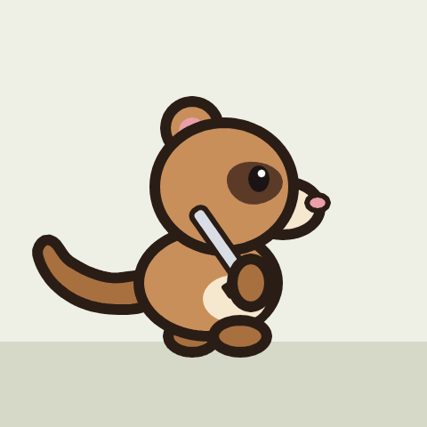
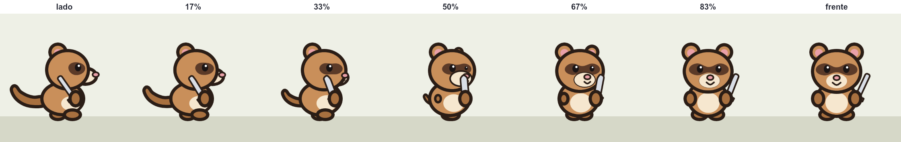

# Virada e metamorfose: um desenho virando outro

**Situação:** análise e protótipo da virada feitos em 13/11/2026, fora do Weasel. Nada implementado. Falta você decidir se vale e dar o "pode fazer".

**Origem:** duas perguntas suas:
- num filme, um personagem que muda de forma (uma aranha virando jacaré);
- num jogo de plataforma, um personagem de lado (com ossos) que em algum momento fica de frente (também com ossos).

## Três coisas parecidas, mas diferentes

| | Mesmo personagem? | Mesmos ossos? | Exemplo | Plano |
|---|---|---|---|---|
| Transição | sim | sim | galope → parado | [transicoes.md](transicoes.md) |
| **Virada** | sim, no mesmo arquivo | não precisa | lado → frente | este |
| **Metamorfose** | não, dois atores | não | aranha → jacaré | este |

A virada e a metamorfose usariam o mesmo código:
1. casar as partes de um desenho com as do outro;
2. transformar o contorno de cada par.

A virada é mais útil para o jogo, e a metamorfose, para o filme.

## O que o Weasel já tem

- **O morph aceita formas com qualquer número de pontos:** `key 12 bolha.shape=estrela` transforma um círculo numa estrela de 10 pontas ([capítulo 7](../guia/07-animacao.md#morph-uma-forma-vira-outra)). O Weasel espalha 72 pontos pelos dois contornos e casa cada um com o mais perto. Só o contorno muda: a cor fica a da forma.
- **Várias vistas no mesmo arquivo:** cada vista numa camada com `only=`, como o [furao.weasel](../../exemplos/furao.weasel) (frente, costas e lado, com os mesmos ossos).
- **Giro 2.5D:** `round=` no osso faz o rosto correr por uma bola, e `yaw=` gira ossos e camadas ([capítulo 11](../guia/11-profundidade.md#uma-cabeça-que-olha-para-os-lados-round)).
- **No filme:** `opacity`, `scale` e `show` dos atores no `at`.

## A virada (lado → frente)

**Jeitos que já funcionam hoje:**
1. **Corte seco.** Num jogo de plataforma, na velocidade do jogo, muitas vezes basta.
2. **Uma animação de virada desenhada:** `anim vira_frente frames=4 once`, com uma vista de 3/4 numa camada `only=vira_frente`. É o jeito clássico (lado → 3/4 → frente); custa desenhar uma vista a mais.
3. **Montar o personagem em 2.5D** (`round=`, `yaw=`, `z=`, `zsort`). Aí virar é só uma `key` de `yaw`. Mas é outro jeito de montar o personagem desde o começo, e as partes chatas (braços, pernas) achatam no meio do giro.

**Jeito novo: virada por morph.**

```
anim vira_frente from=idle_right to=idle_down frames=6
```

- O Weasel casa as partes da vista de lado com as da vista de frente.
- Ele gera os quadros do meio: cada par transforma o contorno, a cor e o contorno (`ink`).
- As partes que só existem numa das vistas nascem de um ponto ou somem nele.
- Quem fica na frente troca no meio.

### O protótipo com o furão





- **Como foi feito:**
  - 16 pares casados à mão (corpo → corpo, cabeça → cabeça, máscara → máscara, olho de lado → olho esquerdo, braço → braço, a espada → a espada…);
  - o olho direito nasce perto do focinho, a orelha de trás atrás da cabeça, o braço esquerdo atrás do corpo, a boca no nariz;
  - a cauda some atrás do corpo;
  - o furão continua respirando (`idle`) durante a virada, porque cada vista usa a pose dela naquele quadro;
  - o alinhamento dos contornos é calculado uma vez, na pose parada; senão o contorno "escorrega" de um quadro para o outro.
- **O que ficou bom:**
  - o olho de lado escorrega pelo rosto até virar o olho esquerdo, enquanto o direito aparece do outro lado, como numa virada de verdade;
  - o focinho comprido encolhe para dentro da cabeça;
  - a cauda some e o braço de trás aparece.
- **Defeitos:**
  - no meio (50%), o desenho fica "derretido": o focinho aparece por cima da máscara, e o braço que nasce ainda é uma bolinha. Na velocidade do jogo isso passa em 1 ou 2 quadros; devagar, fica feio;
  - as partes que nascem pequenas precisam ter o contorno afinado enquanto crescem, senão viram bolinhas pretas;
  - os pontos de onde cada parte nasce foram escolhidos à mão.

### Para virar recurso
- **Casar as partes sozinho:** pelo osso e pela posição (os nomes mudam entre as vistas: `corpoL` e `corpo`). Você corrige só o que sair errado, com `pairs=corpoL:corpo,…`.
- **De onde nasce cada parte nova:** da parte casada mais perto, atrás de quem a esconde. Você corrige com algo como `born=olhoD:focinhoL`.
- **No jogo:**
  - a virada sai como uma animação `once` comum, com poucos quadros na sprite sheet, tocada com `tocar()`;
  - se ela sempre começa da pose parada, é uma peça só; se pode começar de qualquer quadro do andar, entra a regra das peças do [plano das transições](transicoes.md);
  - com `rig=bones`, as partes que mudam de forma já saem como imagens trocadas quadro a quadro, presas ao osso (é assim que o morph sai hoje), então nada muda no Godot.

## A metamorfose (aranha → jacaré, no filme)

**Jeitos que já funcionam hoje:**
1. **Troca com fade:** dois atores no mesmo lugar; um some com `opacity` enquanto o outro aparece. Parece uma imagem se dissolvendo, e não um corpo mudando.
2. **O truque do desenho animado:** a aranha encolhe (`scale`), um clarão ou uma fumaça cobre a troca, e o jacaré cresce no lugar.
3. **Morph à mão:** os dois desenhos no mesmo arquivo, com uma `key … parte.shape=outra` para cada parte. Dá trabalho: casar uma por uma, mudar a cor com outra `key`, encolher as patas que sobram, e o desenho fica preso aos ossos da aranha.

**Jeito novo:**

```
actor aranha "aranha.weasel" 400,500 anim=anda
actor jacare "jacare.weasel" 400,500 anim=anda hidden
at 5s aranha.morph=jacare dur=1.5s
```

- As partes são casadas como na virada (sozinho, ou com `pairs=`).
- Uma pata que sobra encolhe até sumir; o rabo, que não existia, cresce da parte mais perto.
- Os dois continuam se mexendo: uma aranha andando vira um jacaré andando.
- No fim, a aranha some e o jacaré fica, sem pulo.
- Com silhuetas parecidas, a troca fica bonita. Com partes muito diferentes (patas finas virando um rabo), o desenho parece "derreter" de um no outro, que é o visual clássico de morph. Um clarão ou partículas por cima ajudam.
- **No jogo:** nada muda, a menos que um dia você queira exportar a metamorfose como animação.

## No Weasel e no jogo
- **Weasel:**
  - `from=` e `to=` no `anim`, já previstos nas transições, passam a aceitar vistas diferentes (virada);
  - `morph=` no `at` do filme (metamorfose);
  - nenhuma sintaxe existente muda.
- **Jogo:** só ganha quadros quem declarar uma virada.

## Ordem sugerida
1. A virada, junto com as [transições](transicoes.md) (o mesmo `anim … from= to=`).
2. A metamorfose no filme, depois, reaproveitando o mesmo código.

## Para decidir
1. A virada entra junto com as transições, ou separada?
2. Os nomes: `pairs=` e `born=`, ou outros?
3. A metamorfose no filme interessa agora, ou fica para depois?
