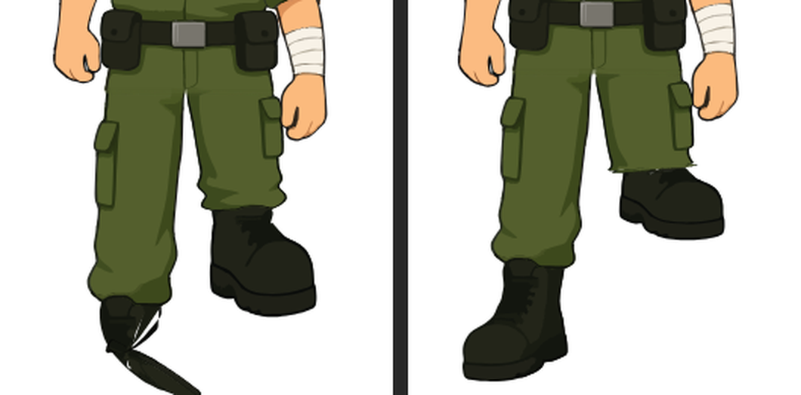

# Sugestões de melhoria para o Weasel: personagens traçados em três vistas

> Importada do projeto ZombieEscapeRoom (`prototipo/proposta-melhorias-weasel-vistas.md`) em 23/11/2026. O texto da
> proposta está como veio; só as duas imagens foram copiadas para [img/](img/). A análise do Weasel, item por item,
> está no fim, em [Análise do Weasel](#análise-do-weasel-23112026).

Sete melhorias para as três vistas (1.75+) e para o traçado de imagem, vindas de um teste real: o soldado do Zombie
Escape Room de frente, de lado e de costas, montado no Weasel 1.78.0. As três primeiras são as que mais pesam, e a
segunda é uma tela para comparar as vistas e corrigir à mão o que não bate entre elas.

## O que foi feito

O soldado foi gerado por IA (Qwen Image) em três vistas. Cada parte do corpo também foi gerada sozinha (cabeça,
tronco, braços e pernas), e cada membro foi cortado nas juntas. Cada peça foi traçada pelo Weasel, e as peças foram
montadas num arquivo de três vistas com ossos.

- **O arquivo:** `ZombieEscapeRoom/prototipo/art/soldado_vistas.weasel`, com 1.330 formas, 33 peças (11 por vista)
  e 20 ossos. Os ossos têm os nomes do `homem3d`.
- **O script que o gera:** `ZombieEscapeRoom/tools/prototipo/rig_vistas.py`.
- **As animações de teste:** `teste_andar` e `teste_correr` são o andar e a corrida do `homem3d`, e saem nas três
  vistas.

**Funcionou bem, e vale não quebrar:**

- O `side=` e o `tip=` nos ossos.
- O `bones=` (a calça dobrando no joelho) e os pinos `@osso` (o cano da bota preso à canela), também nas animações
  geradas.
- A troca de ordem: a perna que vem para a frente passa por cima da outra.
- A medida do "pé no chão" no `--info`.
- A folha de conferência (`--contact`).

## Por que estou pedindo

O Weasel das três vistas foi pensado para peças desenhadas à mão, com uma forma por peça, como o furão e o
`homem3d`. Um personagem traçado de imagens geradas é diferente em três pontos:

- **Cada peça vira dezenas de formas.** O traçado separa as cores em regiões, e o Weasel mede cada osso pela
  **maior forma** dele, que é só uma das regiões de cor.
- **As juntas não ficam na mesma altura nas três vistas.** A IA desenha cada vista com proporções um pouco
  diferentes. Nas imagens (o dobro do tamanho do arquivo), o cotovelo de lado ficou 17 px mais alto que de frente,
  e o cinto 22 px. Como a altura precisa bater, o script estica o lado e as costas antes de traçar.
- **A bota é grande.** Quando o pé gira para a câmera, a bota vira um risco.

Hoje eu contorno tudo isso com scripts. As melhorias abaixo resolveriam no Weasel.

---

## 1. A junta desenhada em cada vista

Hoje os pivôs são os da frente. Nas outras vistas, as peças giram em volta da projeção do pivô da frente:
`(raiz + profundidade, y da frente)` de lado, e o x espelhado de costas. Se a junta desenhada naquela vista está em
outro lugar, a peça gira no ponto errado e abre fresta. Por isso o Weasel avisa quando a altura passa de 8 px.

No soldado, mesmo depois de esticar o lado e as costas, ainda ficaram juntas fora, na escala do arquivo:

- o pescoço, 14 px de lado e de costas (a IA desenhou a cabeça mais curta nessas vistas);
- o ombro direito, 11 px de costas.

Esticar mais deformaria o desenho.

**Como funcionaria**

- O `side=` ganha um y opcional: `side=x,y` é a junta como está desenhada de lado. O x continua sendo a
  profundidade.
- Um `back=x,y` faz o mesmo para as costas. As diagonais seguiriam o mesmo padrão.
- Em cada vista, as peças giram em volta da junta desenhada nela. A animação continua sendo uma só, e o 3D continua
  vindo da frente e da profundidade.
- Com `side=x` sem o y, tudo fica como hoje.
- A conferência de 8 px vira só uma informação no `--info` ("a junta de lado está N px acima da frente"), porque a
  diferença passa a ser permitida.
- As juntas de cada vista aparecem com `--guides` e no editor.

**Detalhes para decidir**

- Se o nome das costas é `back=`, ou se segue o nome da vista (`up=x,y`, `right=x,y`).
- Se, sem `back=`, as costas continuam com o x espelhado da frente, como hoje.

**Sugestão.** Em `views.js`, o lugar parado de cada osso em cada vista (o `xy` / `rv` que o `localsOf` usa, hoje a
projeção do pivô em 3D) passaria a ser a junta desenhada, quando houver. O lugar animado (`cur`, no `scr`) seria
montado descendo a corrente: o lugar do pai mais a matriz do pai na tela aplicada ao segmento desenhado entre a junta
do pai e a do filho. Assim, pai e filho não se separam, mesmo com juntas diferentes em cada vista. As keys geradas
continuam em volta do `pivot=`, como hoje.

**Ganho:** a etapa de esticar as vistas sai do fluxo, e os desenhos ficam como a IA (ou a pessoa) os fez.

## 2. Uma tela para comparar as vistas e corrigir o desalinhamento

Hoje, para saber se as juntas batem entre as vistas, eu faço folhas por fora (as juntas de cada vista desenhadas
sobre o desenho parado) e leio uma tabela que o script imprime. O editor já tem a **Vistas em 3D** (as placas de
cada vista em volta do boneco) e o **Prender** (arrastar a bolinha de um osso na vista de lado grava o `side=`). Mas
nenhum dos dois põe duas vistas lado a lado, na mesma altura, com as juntas marcadas: o pescoço do soldado, 14 px
fora de lado, não aparece em nenhum deles.

*(Esboço montado com o soldado de verdade: os desenhos parados de frente e de lado e as juntas medidas pelo script,
depois de ele esticar o lado. A imagem original está em
`ZombieEscapeRoom/prototipo/capturas/soldado_vistas/esboco_comparar_vistas.png`.)*

**A tela**

- **Duas vistas lado a lado**, escolhidas em dois menus (frente, lado, costas e, quando houver, as diagonais), na
  mesma escala e com o chão na mesma linha.
- **Sobrepor:** um terceiro painel com uma vista por cima da outra, e um controle de transparência.
- **Espelhar costas:** as costas viradas na horizontal, para comparar com a frente.
- **Linhas de altura:** uma linha tracejada na altura de cada junta da vista principal, cruzando os painéis, com o
  nome da junta na margem.
- **As juntas de cada vista:** na vista principal, os pivôs. Na outra, a junta desenhada (o `side=x,y` do item 1;
  sem ele, o pivô projetado, como hoje). Cada bolinha tem um traço até a sua linha e a diferença em px, com cor:
  verde até 4 px, amarelo até 8 e vermelho acima de 8 (o mesmo limite do aviso de hoje).
- **A lista:** embaixo dos painéis, os mesmos números, junta por junta. Clicar num deles seleciona o osso e mostra a
  linha dele no código. Os avisos de altura do `--info` entram aqui também.
- **Com o player:** os painéis acompanham o quadro da animação. Uma fresta que abre numa junta, num quadro só,
  aparece na hora.

**As correções, na própria tela**

1. **Mexer a junta.** Arrastar a bolinha de uma junta na vista de lado grava `side=x,y` no osso (`back=x,y` nas
   costas). É o Prender de hoje, com o y do item 1. O desenho não sai do lugar: a peça só passa a girar ali. Serve
   quando a vista foi desenhada diferente de propósito, como a cabeça mais curta do soldado de lado.
2. **Mover a peça.** Arrastar para cima ou para baixo a peça de um osso naquela vista (todas as formas dele, como no
   item 3); as setas movem 1 px. Grava os pontos no lugar novo. Serve quando uma peça está fora e o resto está
   certo, como o ombro direito do soldado de costas, 11 px fora.
3. **Esticar entre linhas.** Serve quando a vista inteira saiu com outra proporção (de lado, o cotovelo do soldado
   saiu 17 px mais alto que de frente, e o cinto 22, na escala da imagem). A pessoa clica no mesmo ponto nas duas
   vistas (o cotovelo, o cinto, a sola…), e o Weasel estica a vista em y, faixa por faixa, entre uma marca e a
   seguinte, até cada marca cair na sua linha. Tem prévia e Ctrl+Z, e grava os pontos esticados.
   - É a etapa `alinhar` do meu script, que hoje roda nas imagens antes de traçar. Nos pontos é mais simples: cada
     ponto, e cada ponta de degradê, passa pela mesma régua de y.
   - O script recusa uma marca que apertaria ou esticaria uma faixa para fora de 0,8 a 1,25 vez: além disso, o
     desenho fica visivelmente deformado. A tela pode avisar a mesma coisa, pintando a faixa.

**Na linha de comando**

- `weasel soldado_vistas.weasel --compare down,right -o comparar.png`: uma folha parada como o esboço, com as duas
  vistas, as linhas, as bolinhas e os números, do jeito do `--contact`. Com `--anim teste_andar`, uma fileira por
  quadro.
- O `--info` mostra a mesma tabela em texto, por exemplo `juntas (right − down): pescoço −14, ombro −8, pulso +6`.

**Detalhes para decidir**

- Onde fica: um modo novo da Vistas em 3D, ou um item no menu Exibir.
- Se o Esticar entre linhas grava os pontos já esticados (o arquivo fica simples, mas o desenho de antes se perde) ou
  uma opção na camada, como `layer v view=right stretch=…` (o desenho de antes fica, e dá para desfazer depois).
- Se as linhas usam só as juntas ou também o contorno: o alto da cabeça e a sola não são juntas, mas precisam
  bater.

**Ganho:** o desalinhamento passa a ser visto e corrigido no editor, por quem desenha, em vez de num script. Com o
item 1, a pessoa escolhe em cada junta se mexe na junta (a vista fica como foi desenhada) ou no desenho (a vista
passa a bater com a frente).

## 3. Medir o osso por todas as formas dele, não pela maior

O `biggest(vista, osso)` de `views.js` escolhe a forma de caixa maior e a usa para quatro coisas:

- a profundidade, quando não há `side=`;
- a direção, quando não há `tip=` nem um filho só;
- a grossura;
- a conferência de altura entre a frente e o lado.

Na arte traçada, a maior forma é só uma mancha de cor. No `--info` do soldado:

- **Grossura** (de lado a lado / de frente para trás): `cabeca 142.3/8.1 · antebracoE 26.9/2.8 · maoE 27.3/4`. De
  lado, a cabeça tem uns 150 px de frente para trás, não 8, e o antebraço uns 25, não 2,8. É a grossura que decide
  quando duas peças trocam de ordem.
- **Os 5 avisos de altura:** `cabeca: a peça está em y=75,7 na frente e em y=99,9 de lado`. Esse aviso compara o
  cabelo da frente com o rosto do lado. Os de `tronco` (269,5 e 259,8), `bracoE` (253,3 e 245), `bracoD` (256,1 e
  244,9) e `coxaD` (424,8 e 410,8) vêm do mesmo problema.

**Como funcionaria**

A peça de um osso numa vista passa a ser **todas as formas dele juntas**:

- a caixa é a união das caixas, e dela saem o centro e a área;
- a grossura vai do primeiro ao último cruzamento da reta com qualquer forma do osso (o `widthAcross` em todas, com
  o menor `lo` e o maior `hi`);
- a profundidade é o centro da união.

Não precisa de sintaxe nova. Numa peça de uma forma só, nada muda.

**Detalhes para decidir**

- **Formas com `bones=`.** Hoje uma forma em `bones=coxaD,canelaD` conta como peça do primeiro osso, e a calça
  inteira contou como `coxaD`. Pode continuar assim, ou a forma pode contar para cada osso, pelo peso.
- **A conferência de altura.** Mesmo com a união, a extensão das peças varia de verdade entre as vistas: de frente o
  tronco vai até o quadril, de lado para no cinto. Com a junta de cada vista (item 1), a conferência compararia as
  juntas. Sem ela, poderia avisar só quando o alto **e** o baixo da peça mudam para o mesmo lado.
- **Opcional:** um `group nome bone=osso … end` valer como "a peça", em vez de servir só para o editor, como hoje.

## 4. Quanto uma peça pode encurtar, por osso

Quando um osso gira para a câmera ou para longe dela, a peça encurta ao longo dele. O limite é igual para todos os
ossos, de 10% a 1,4 vez (`MINLEN` e `MAXLEN` em `views.js`). Uma bota grande que gira vira um risco escuro: o
desenho 2D não tem como mostrar o pé de ponta, e o Weasel o achata até 10%.

*(A imagem original está em `ZombieEscapeRoom/prototipo/capturas/soldado_vistas/evidencia_bota_risco.png`.)*

No soldado:

- Com o pé apontando para a ponta da bota (`tip` 73 px para a frente), a bota virou risco no quadro 0 do andar de
  frente.
- Com o pé apontando para baixo, ela virou risco nos quadros 1 e 5, quando o pé vai para trás.
- O contorno foi apontar o pé a 45°, para baixo e para a frente. Assim ele aguenta de −108° a +72°.
- A barra da calça também fica chata na corrida, quando a canela dobra para trás (−100°).

**Como funcionaria**

- `bone peD … minlen=0.6` (e `maxlen=`): o limite desse osso.
- `bone cabeca … shorten=off`: a peça só gira, nunca encurta. Serve para pés, mãos e cabeça.
- **Opcional:** `hide=0.3`. Abaixo desse tamanho, a peça some (como um pé que passa para trás da perna), em vez de
  virar um risco.

## 5. O pé no chão sozinho

O `--info` já mede, quadro a quadro, quanto o pé mais baixo fica acima do chão, e avisa quando ele afunda. Quando
copiei o andar do `homem3d` para o soldado (pernas e botas de outro tamanho), os pés afundavam até 30 px. Eu corrigi
mudando o quadril em cada key: um script lê o "pé no chão" do `--info` e reescreve as keys, em duas passadas.

**Como funcionaria**

- `anim walk … ground`: em cada quadro, a raiz sobe ou desce para o pé mais baixo encostar no chão.
- `anim run … ground=floor`: só sobe quando o pé afundaria. A fase no ar da corrida, com os dois pés fora do chão,
  continua no ar.
- A conta é feita no 3D, antes das vistas, e as três saem iguais. O `--info` mostra quanto foi corrigido em cada
  quadro.

## 6. Traçado: escala na saída, prefixo e osso

Hoje, para cada peça, faço três coisas por fora:

- **Escala.** O `-s 0.5` reduz a imagem **antes** de traçar. Na metade, uma mão de 40 px saiu com o contorno
  tracejado e os dedos borrados. Por isso traço no tamanho da imagem e um script divide as coordenadas por 2: o
  `canvas`, os pontos, as pontas dos degradês e a escala da `ref`.
- **Nomes.** Com 33 peças num arquivo, os `color1…`, `gradient1…` e `_hole1…` de cada traçado colidem. O script
  troca os nomes por `f_manga_e_1`, `f_manga_e_g1`, `f_manga_e_furo1`…
- **Ossos.** O script põe o `bone=` (ou o `bones=`) em cada forma.

**Como funcionaria**

- `--out-scale 0.5`: traça no tamanho da imagem e grava as coordenadas na escala pedida.
- `--prefix manga_e`: os nomes da paleta, dos degradês e dos buracos saem com o prefixo.
- `--bone bracoE` (ou `--bones antebracoD,maoD`): o osso em todas as formas.

## 7. A troca de ordem do `--info`, por osso

Com arte traçada, a linha "ordem troca" lista centenas de linhas: `teste_correr_down: em 8 de 8 quadros (linha 526,
linha 527, linha 528, …)`. Assim, não dá para saber o que trocou com o quê.

**Como funcionaria:** a troca é mostrada por par de ossos e por quadros, por exemplo "coxaE passa na frente de coxaD
nos quadros 0–3". A lista de linhas fica para uma opção a mais, como `--info --verbose`.

---

## Para conferir

Com o soldado e o `rig_vistas.py`:

- **Item 1:** a etapa `alinhar` do script pode sair, e o lado e as costas entram como a IA os desenhou, com `side=x,y`
  e `back=x,y`.
- **Item 2:** a tela, com frente e lado, mostra o pescoço em vermelho (−14) e o ombro e o pulso em amarelo, como no
  esboço. Arrastando a junta do pescoço de lado, a linha fica verde e o pescoço não abre fresta no andar de lado.
  Com o lado sem esticar (o traçado direto da imagem da IA), o Esticar entre linhas no cotovelo, no cinto e no joelho
  deixa o lado como o `alinhar` do script deixa.
- **Item 3:** os 5 avisos de altura somem (ou passam a comparar as juntas), e a grossura de lado da cabeça e do
  antebraço fica perto de 150 e de 25.
- **Item 4:** o `tip=` do pé volta para a ponta da bota, com `minlen=` ou `shorten=off`, e os quadros 0, 1 e 5 do
  andar de frente mostram a bota inteira.
- **Item 5:** o laço que corrige o quadril pelo `--info` sai do script.

---

## Análise do Weasel (23/11/2026)

A pergunta é se cada item faz sentido para o Weasel, que é ao mesmo tempo um desenho em código e um editor visual,
para jogos (Godot) e para filmes. Antes dos itens, quatro fatos que pesam em todos:

- **A proposta descreve o código como ele é.** Conferi cada ponto em `js/views.js` e rodei o `--info` no
  `soldado_vistas.weasel`: os 5 avisos de altura, a grossura `cabeca 142.3/8.1` e `antebracoE 26.9/2.8`, o
  `MINLEN = 0.1` e `MAXLEN = 1.4` iguais para todos os ossos, e a linha "ordem troca" com centenas de `linha N`. Está
  tudo lá.
- **A arte traçada é um caminho do próprio Weasel.** O traçado de imagem entrou na 1.70.0 (linha de comando) e na
  1.71.0 (Objeto › Traçado de imagem). Um personagem traçado montado em três vistas é um uso esperado, não um desvio.
- **As três vistas são de hoje** (1.75.0 a 1.78.0). Fora do Weasel, só o soldado usa. Mudar as medidas agora custa
  pouco: são os 4 exemplos, as referências dos testes e o capítulo 17.
- **Nada aqui muda o lado do jogo.** As `key` geradas continuam em volta do `pivot=`, e o lugar de cada osso em cada
  vista já vai para o Godot pelo `anim.voff` (o `V.off` de `views.js`). O ajudante do Godot e as cenas não mudam.

### Em resumo

| # | Item | Faz sentido? | Tamanho | O que eu recomendo |
|---|---|---|---|---|
| 3 | Medir o osso por todas as formas | sim: é um conserto | pequeno | fazer primeiro, com o centro pesado pela área |
| 7 | A troca de ordem por osso | sim | pequeno | fazer, sem `--verbose` |
| 6 | Traçado: escala, prefixo e osso | sim | pequeno | fazer: o editor já faz metade |
| 4 | Quanto uma peça encurta, por osso | sim | pequeno | um nome só, `shorten=`; o `hide=` não |
| 1 | A junta desenhada em cada vista | sim | médio | fazer, mas com outra conta (abaixo) |
| 2 | Comparar vistas | ver: sim; corrigir: em parte | grande | ver e corrigir a junta e a peça; o esticar por último, se ainda fizer falta |
| 5 | O pé no chão sozinho | sim | médio | fazer, ligado na `anim` |

O que serve só para quem traça (o 6 e o esticar do 2) é barato ou fica por último. O resto também ajuda quem
desenha à mão: num model sheet de animação, a cabeça de perfil quase nunca tem a mesma altura que a de frente, e o
desenhista "rouba" de propósito.

### Item 3: medir o osso por todas as formas

**Faz sentido.** O `biggest()` escolhe uma forma por osso, e numa peça traçada isso é uma mancha de cor. É um
conserto, sem sintaxe nova.

**Mas muda os exemplos feitos à mão.** Medi a diferença entre o centro da maior forma e o centro de todas, nos 4
exemplos (eles também têm várias formas por osso: a cabeça com olhos, nariz e cabelo):

| Peça | Centro da caixa da união (a proposta) | Centro pesado pela área de cada forma |
|---|---|---|
| herói, cabeça de lado | 7,3 px para a frente | 3,3 px para a frente |
| herói, cabeça de frente | 4,8 px de lado | 1,5 px de lado |
| guarda, cabeça de frente | 10,8 px para cima | 5,2 px para cima |
| guarda, perna de lado | 2 px para a frente | 0,6 px para a frente |

A caixa da união anda muito por causa de pedaços pequenos que saem da peça (o nariz de perfil, a ponta do cabelo).
O centro pesado pela área quase não liga para eles e continua certo na arte traçada, onde cada região conta pelo
tamanho dela.

**O que eu mudaria:**

- **A profundidade e a direção** (sem `side=` e sem `tip=`): o centro pesado pela área de todas as formas do osso.
- **A grossura e a caixa:** a união, como a proposta diz (o `widthAcross` em todas as formas, com o menor `lo` e o
  maior `hi`).
- **As formas com `bones=`:** continuam contando para o primeiro osso. Dividir pelo peso pode vir depois, se fizer
  falta.
- **A conferência de altura:** com o item 1, ela compara as juntas. Antes dele, avisa só quando o alto **e** o baixo
  da peça mudam para o mesmo lado (como a proposta sugere).
- **O `group … bone=` valendo como peça:** não. Hoje o `group` é só do editor, e ele ganharia um segundo sentido.

Os exemplos mudam alguns pixels. As referências dos testes são refeitas, e mando as imagens de antes e depois.

### Item 7: a troca de ordem por osso

**Faz sentido, e ajuda todo mundo.** Até no herói, a lista de linhas não diz quem passou na frente de quem. A
`orderOf()` já compara osso com osso: basta guardar os pares que trocaram e os quadros, por exemplo
`coxaE passa na frente de coxaD nos quadros 0–3`.

**O que eu mudaria:** sem o `--verbose`. A linha de comando não tem essa opção, e o nome do osso já leva às linhas
dele.

### Item 6: traçado com escala, prefixo e osso

**Faz sentido, e é quase só ligar fios.** O `lines(res, how)` de `js/trace.js` já aceita um `map` (de onde para onde
vão os pontos) e os nomes das cores, dos degradês e dos buracos. O Objeto › Traçado de imagem do editor já usa isso
para pôr o traçado no lugar do `ref` sem colidir nomes. Falta a linha de comando:

- `--out-scale 0.5`: traça no tamanho da imagem e grava os pontos, as pontas dos degradês, o `canvas` e o `scale=`
  da `ref` na escala pedida. O `-s` continua como é (não quebra quem já usa).
- `--prefix manga_e`: `manga_e_color1`, `manga_e_gradient1`, `_manga_e_hole1`. O `_` na frente dos buracos continua,
  como nos nomes automáticos da 1.64.1.
- `--bone bracoE` ou `--bones antebracoD,maoD`: em todas as formas.

### Item 4: quanto uma peça encurta, por osso

**Faz sentido.** Uma bota, uma mão ou uma cabeça desenhadas chapadas não podem encurtar como uma espada, e o
contorno de apontar o pé a 45° mostra que hoje não há saída na linguagem. O "encurta até 10%" da tabela de limites
do capítulo 17 continua valendo para quem não muda nada.

**O que eu mudaria:**

- **Um nome só,** em vez de três: `shorten=off` (a peça só gira), `shorten=0.6` (encurta até 60%) e, se precisar,
  `shorten=0.6,1.2` (o mínimo e o máximo). Uma coisa, um jeito de escrever (é a ideia da limpeza da linguagem).
- **O `hide=`, não.** O capítulo 17 diz que o encurtar para em 10% de propósito, para um osso não sumir. Uma peça que
  some e volta pisca entre os quadros (no filme, a 24 quadros, dá para ver), e a troca de ordem já põe o pé atrás da
  perna quando ele vai para trás.
- **A barra da calça na corrida** está certa como conta: a canela dobrada para trás, vista de frente, aponta para
  longe da câmera. Um `shorten=0.6` na canela suaviza.

### Item 1: a junta desenhada em cada vista

**Faz sentido, e não só para a IA.** Num model sheet feito à mão, a cabeça de perfil é desenhada mais curta ou mais
comprida de propósito. Hoje o Weasel exige que todas as vistas batam com a frente.

**A sintaxe está boa.** `side=x,y` estende o `side=` que já existe, e `side=x` sem o y continua igual. Para as
costas, `back=x,y`. Sem `back=`, as costas continuam com o x espelhado da frente. As diagonais e o jogo de
plataforma (que usa `lat=`, não `side=`) ficam para quando alguém precisar: o soldado não tem diagonais.

**A conta sugerida quebra o `yaw`.** A proposta monta o lugar animado descendo a corrente: o lugar do pai mais a
matriz do pai na tela aplicada ao segmento desenhado. Essa matriz só gira e encurta a peça ao longo do osso, e a
largura fica. Quando o tronco gira com `yaw`, ele não parece girar de frente: a matriz dele fica parada, e os ombros
ficariam parados também. No golpe do herói (`corpo.yaw=20`), hoje o ombro direito desce 2,4 px de frente, porque foi
para a frente em 3D. Com a conta da proposta, ele não se mexeria, e num giro de 90° os braços não chegariam um perto do
outro.

**O que eu faria:** o lugar animado continua sendo o 3D projetado, como hoje, **mais a diferença desenhada** (a junta
desenhada menos a junta projetada), girada e encurtada com a matriz do pai na tela. Parado, a junta fica exatamente
onde foi desenhada. Andando, os 14 px do pescoço acompanham o tronco, e o 3D dos ombros continua. A fresta entre pai e
filho é a de hoje mais um erro pequeno, sobre a diferença.

**Antes de escrever no Weasel,** um protótipo, como na etapa 0 das três vistas: o soldado sem a etapa `alinhar`, com
`side=x,y` no pescoço, e o andar de lado sem fresta no pescoço.

**O aviso de 8 px** continua para os ossos sem `side=x,y` (ele pega erro de verdade). Com `side=x,y`, a diferença
vira informação no `--info`.

### Item 2: uma tela para comparar as vistas

**A parte de ver faz muito sentido.** É a folha de turnaround com as linhas de altura, a ferramenta mais velha de
quem desenha personagem em várias vistas. Hoje o único jeito de ver o desalinhamento é ler o aviso. Serve para
qualquer personagem em três vistas, traçado ou não. A `--compare` na linha de comando segue o jeito da `--contact`, e
a tabela em texto no `--info` é barata.

**As correções, uma por uma:**

1. **Mexer a junta:** sim. É o Prender de hoje com o y, e vem junto com o item 1.
2. **Mover a peça:** sim, mas reaproveitando. A Seleção e as setas já movem formas. Falta clicar numa peça da tela de
   comparar e selecionar todas as formas daquele osso naquela vista. Daí em diante, é o editor de sempre.
3. **Esticar entre linhas:** faz sentido, mas é o pedaço maior e o mais preso à arte gerada. Eu deixaria por último,
   para quando os itens 1 e 3 estiverem feitos e o soldado ainda precisar. Quando vier, ele grava os pontos esticados,
   sem um `stretch=` na camada: uma opção da linguagem que só existe para consertar a entrada pesa para sempre, e o
   Ctrl+Z e o git já guardam o desenho de antes. A faixa fora de 0,8 a 1,25 aparece pintada.

**Onde fica:** Exibir › Comparar vistas, um modo da área de desenho, como a Vistas em 3D. Não dentro dela: a Vistas
em 3D é uma câmera em 3D, e esta tela é plana.

**As linhas:** as juntas, mais duas que saem sozinhas: o alto do desenho e o chão. A cabeça mais curta do soldado
aparece no alto, mesmo sem ser junta.

### Item 5: o pé no chão sozinho

**Faz sentido, para jogo e para filme.** Passar uma animação de um personagem para outro, com pernas de outro
tamanho, é comum nos dois. O Weasel já mede o pé no chão em cada quadro (`V.ground`). Falta usar a medida: em cada
quadro, a raiz sobe ou desce, e o 3D é montado de novo. As três vistas saem iguais.

**Detalhes para a hora:**

- Os nomes `ground` (encosta sempre) e `ground=floor` (só não afunda; o pulo continua no ar) estão bons.
- O `bob=` é somado depois das `key`: o `ground` não o apaga.
- Começa só nas três vistas, onde a medida existe. No 2D comum, se alguém pedir.

### Ordem sugerida

1. **Etapa A, consertos sem sintaxe nova:** os itens 3 e 7. Eles mudam as medidas que os itens 1 e 2 mostram, então
   vêm antes.
2. **Etapa B, linguagem pequena:** os itens 4 (`shorten=`) e 6 (o traçado).
3. **Etapa C:** o item 1, com o protótipo antes.
4. **Etapa D:** o item 2 (ver, mexer a junta, mover a peça) e a `--compare`.
5. **Etapa E:** o item 5.
6. **Depois, se ainda fizer falta:** o esticar entre linhas.

### Para decidir

1. **Item 3:** o centro pesado pela área (a minha recomendação) ou o centro da caixa da união (a proposta)? E os 4
   exemplos podem mudar alguns pixels, com as imagens de antes e depois?
2. **Item 1:** `side=x,y` e `back=x,y`, com as diagonais e o jogo de plataforma para depois? E a conta do 3D mais a
   diferença, no lugar da corrente?
3. **Item 2:** Exibir › Comparar vistas, e o esticar por último, gravando os pontos?
4. **Item 4:** `shorten=` no lugar de `minlen=`, `maxlen=` e `shorten=off`, e sem o `hide=`?
5. **Item 6:** os nomes com prefixo (`manga_e_color1`, `_manga_e_hole1`)?
6. **Item 7:** sem o `--verbose`?
7. **Um teste com o soldado:** um pedaço dele (a cabeça, o tronco e um braço, com poucas formas) nos testes, para as
   medidas da arte traçada não voltarem a quebrar?

### Situação

**Etapa A (itens 3 e 7): feita em 23/11/2026**, com as recomendações acima (o centro pesado pela área, a união para a
grossura e a caixa, a conferência de altura pelo alto e pelo baixo, sem `--verbose`).

- **No soldado:** a grossura da cabeça foi de 142,3/8,1 para 148,3/133,4, e a do antebraço esquerdo, de 26,9/2,8
  para 28,3/34,1. Dos 5 avisos de altura, ficou 1, o do tronco. Ele parece de verdade: de lado, o tronco inteiro está
  15,5 px mais alto (o alto 26 px, o baixo 15,5). As formas escondidas (os buracos de um `cut=`) e as camadas `guide`
  não entram na medida.
- **A troca de ordem:** `ordem troca  walk_up: em 8 de 8 quadros: capa na frente de bracoE (0–2, 6–7), …`. Ela achou
  um erro no capítulo 17, que dizia que, na estocada do guarda, a lança passa na frente da mão: é o braço que passa
  na frente da lança (quadros 2 a 6).
- **Nos exemplos:** as profundidades mudaram até 3,3 px (a cabeça do furão: de 4 para 7,2, puxada pelo focinho), e os
  desenhos, 1 a 2 px. No golpe do guarda, a mão fica na frente da haste também nos quadros 1 e 6, como nos quadros 2
  a 5. A régua do capítulo 17 (`17_regua.png`) e as amostras do `--info` foram refeitas.

