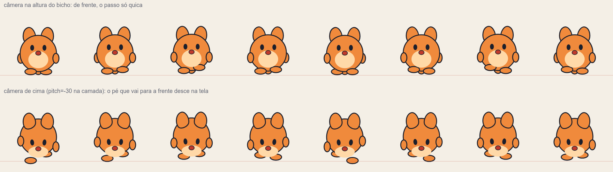
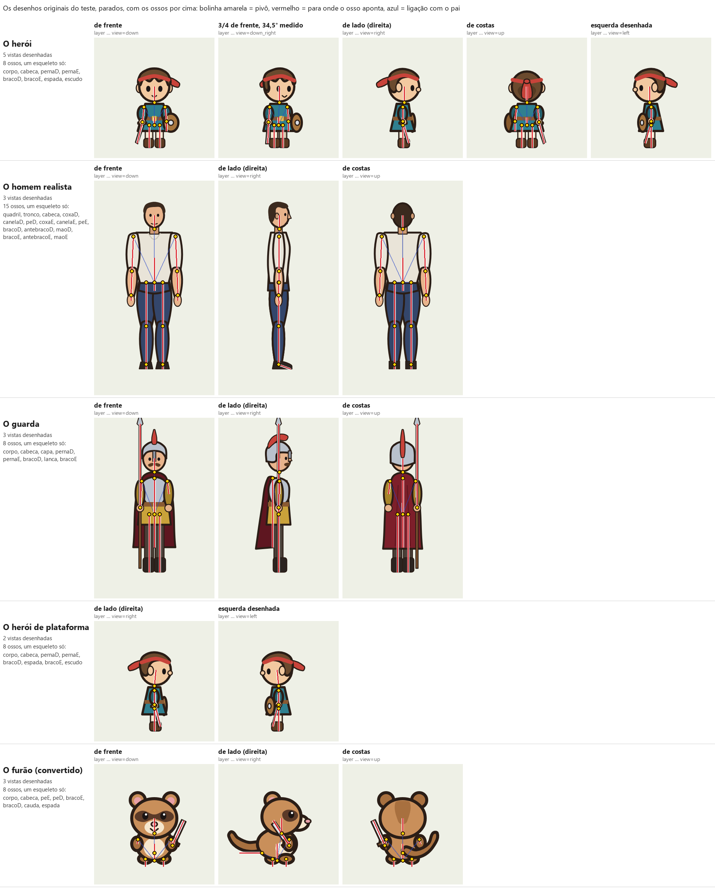
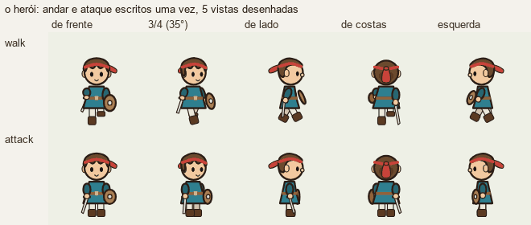
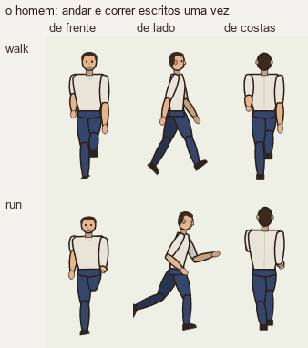
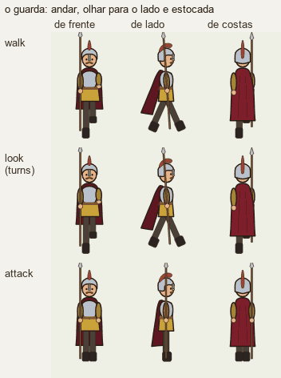
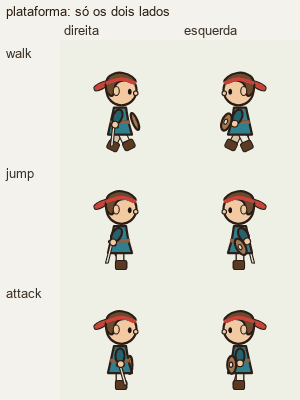
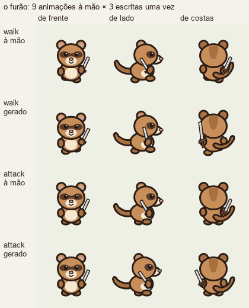

# Três vistas, uma animação

**Situação:** proposta de 23/11/2026. No mesmo dia, as diagonais e os dois lados desenhados entraram como possibilidades, e a etapa 0 (o protótipo, fora do projeto) foi feita: veja [o protótipo](#o-protótipo-etapa-0). Depois do teste, entrou a vista [Vistas em 3D](#vistas-em-3d), e você aceitou todas as recomendações: veja [o que foi decidido](#o-que-foi-decidido-23112026). A etapa 1a (as vistas e os movimentos) foi feita na 1.75.0, no mesmo dia: veja [como ficou](#como-ficou-a-etapa-1a-1750). A etapa 1b (os giros) foi feita na 1.76.0, também no mesmo dia: veja [como ficou](#como-ficou-a-etapa-1b-1760). A próxima é a [etapa 2](#etapas) (o editor, começando pela vista Vistas em 3D), esperando o seu "pode fazer".

**Origem:** a sua pergunta de 23/11/2026. Num jogo 2D visto de cima, tipo Zelda, o personagem precisa de quatro direções (baixo, cima, direita e esquerda). Desenhar cada uma já é trabalho; animar cada uma (andar, atacar, parado) multiplica o trabalho por três. A ideia: você desenha o personagem de frente, de lado e de costas, e o Weasel monta com isso um boneco "em 3D", que você anima uma vez só.

Na maior parte do tempo, são as quatro direções, com a esquerda espelhada. Duas coisas ficam como **possibilidade**; sem elas, nada muda:
- as diagonais, quando você desenhar uma vista de 3/4 ([vistas na diagonal](#vistas-na-diagonal-opcional));
- os dois lados desenhados, para um personagem assimétrico, tanto no jogo visto de cima quanto num jogo de plataforma, que só tem os dois lados ([os dois lados desenhados](#os-dois-lados-desenhados-opcional)).

**Weasel:** a linguagem, a exportação e o editor. **Jogo:** nada muda. Saem as mesmas animações de hoje (`walk_down`, `walk_right`, `walk_up` e o `_left` espelhado), e o `tocar("walk", velocity)` escolhe a direção.

## O problema, com o furão

O [furao.weasel](../../exemplos/furao.weasel) já é um personagem de jogo visto de cima, com três vistas (camadas `frente`, `costas` e `lado`, cada uma com `only=`). Para ter três movimentos, ele precisa de:

- **9 animações:** `idle`, `walk` e `attack`, cada uma em `_down`, `_up` e `_right`. O `walk_down` e o `walk_up` são quase iguais; o `walk_right` é outro movimento, escrito à parte.
- **3 ossos para a mesma espada** (`espadaF`, `espadaC` e `espadaL`), porque a espada fica num lugar diferente em cada vista.
- **3 caixas de golpe** (`golpe_down`, `golpe_up` e `golpe_right`), uma por direção, posicionadas à mão.

E um defeito que não aparece: os ossos têm um pivô só, o da frente. Na vista de lado, o braço (`bracoL`, em x=94) gira em volta do pivô da frente (`bracoD`, em x=102).

Com este plano, o furão teria **3 animações**, **um osso de espada** e **uma caixa de golpe** presa a ele.

## O que o Weasel já tem

- **Vistas no mesmo arquivo:** camadas com `only=`, como no furão. O `pose` mostra a frente no desenho parado.
- **Direções no nome da animação:** `_down`, `_up`, `_right`, `_left` e as diagonais. As transições, o `trocar()` e o `tocar()` já entendem esses nomes; a exportação para o Godot cria o `_left` espelhado (`--no-mirror` desliga), e também as diagonais da esquerda. O espelho só cria o lado que falta ([godot.js](../../js/godot.js), `playerAnims`): um `walk_left` escrito é usado como está.
- **As diagonais no `tocar()`** ([godot.js](../../js/godot.js), `nome_com_direcao`): com as duas (`_down_right` e `_up_right`), ele divide o círculo em 8 fatias. Com só a de baixo, andando para cima na diagonal ele cai na direção reta mais perto: 6 direções, sem mudar nada no Godot.
- **Caixas e pontos presos a ossos:** `box … bone=` e `point … bone=` seguem o osso, inclusive girando junto.
- **Casar peças de duas vistas pelo nome, pelo osso, pela cor e pela distância:** é o que a virada (`anim … turn`, 1.45.0) faz para achar o par de cada peça (`corpo` e `corpoL`). Este plano reaproveita esse casamento.
- **2.5D:** `z=`, `yaw=` e `pitch=` em ossos e formas, `round=`, `billboard` e `zsort` ([capítulo 14](../guia/14-profundidade.md)).
- **Assar no Godot:** com `rig=bones`, o `ik` já sai como poses prontas, quadro a quadro.

## O teste de 23/11/2026

Antes do plano, um bichinho desenhado **só de frente** foi montado com o 2.5D de hoje: cada peça com um `z=` e o corpo girando com `corpo.yaw`.


- **Peças que giram como cartas** (sem `billboard`): de lado, viram riscos. Não serve.
- **Peças que só mudam de lugar** (`billboard`): a frente, o lado e as costas saem sozinhos; o braço de longe some atrás do corpo, o rabo aparece de costas. Mas de lado a barriga sai do contorno e o olho fica na borda.
- **Olhos e barriga colados na bola** (`round=`): de lado, o olho vira um fiapo e a barriga some. É a geometria certa, mas desenho animado trapaceia no perfil.

**A lição:** a posição das peças pode vir do 3D, mas o **desenho** de cada vista tem que ser o seu. Daí as três vistas.

Depois, o passo foi animado uma vez, com o pé indo para a frente no `z`, e visto com a câmera de cima:




- Com a câmera na altura do bicho, o passo de frente só **quica no lugar**.
- Com a câmera de cima, o pé que vai para a frente **desce na tela**, e o passo lê como andar na sua direção.
- O teste girou a câmera (`pitch=-30` na camada), o que também achata a altura, e as orelhas passaram para a frente da cabeça (o `billboard` mede a profundidade pela base da peça). Nenhum dos dois acontece no recurso: ele não gira a câmera nem usa o `billboard` (veja [a câmera](#a-câmera-do-jogo) e [quem fica na frente](#quem-fica-na-frente)).

O arquivo do teste ficou fora do projeto; as imagens estão em `img/`.

## O protótipo (etapa 0)

Feito em 23/11/2026, fora do projeto. Nada no Weasel mudou.

### O que foi feito

- **Um script** lê um `.weasel` escrito na sintaxe deste plano: `views tilt=30`, `layer … view=`, `bone … side= tip= lat= turns` e animações sem direção no nome, com `osso.z=`, `osso.pitch=` e `osso.yaw=`. Ele escreve um `.weasel` comum, que o Weasel de hoje desenha sem saber de 3D:
  - uma animação por vista (`walk_down`, `walk_right`, `walk_up`…);
  - cada quadro numa `key` normal (`osso=dx,dy,giro,sx,sy`), com os ossos sem pai;
  - a ordem das peças em `z=`, numa camada `zsort`.

  É a [pose 2D comum](#cada-vista-é-uma-pose-2d-comum) de cada vista, só que escrita no arquivo em vez de calculada na hora.
- **Em cada quadro,** o script:
  1. calcula a pose em 3D de cada osso;
  2. projeta o osso em cada vista: o x mistura o lado e a profundidade pelo ângulo da vista, e o y desce 0,5 px por pixel para a frente (a câmera de 30°);
  3. mede o quanto o osso parece girar e encurtar na tela;
  4. decide a ordem das peças.
- **Os personagens:** quatro homens desenhados para o teste (os desenhos são meus, então medem o método, não a arte) e o furão convertido. Cada animação foi escrita uma vez.
- **Onde ficou:** os originais estão em [`tres-vistas/`](tres-vistas/), ao lado deste plano. O script fica em `.claude/tres-vistas/`, fora do git.

### Os originais

Cada personagem tem só as vistas que o caso dele pedia, e **um esqueleto só**, e não um por vista:

| Personagem | Vistas desenhadas | O `_left` | Ossos |
|---|---|---|---|
| [O herói](tres-vistas/heroi.weasel) | 5: frente, 3/4, lado, costas e esquerda | desenhado | 8 |
| [O homem realista](tres-vistas/homem.weasel) | 3: frente, lado e costas | espelho do lado | 15 (com joelho, cotovelo e pé) |
| [O guarda](tres-vistas/guarda.weasel) | 3: frente, lado e costas | espelho do lado | 8 |
| [O herói de plataforma](tres-vistas/plataforma.weasel) | 2: direita e esquerda | desenhado | 8 |
| [O furão](tres-vistas/furao3d.weasel) | 3: as do `exemplos/furao.weasel` | espelho do lado | 8 |



Os ossos são escritos uma vez, no alto do arquivo, com o lugar tirado do desenho de frente (no de plataforma, do lado direito). Cada vista é uma camada com as peças dela, e cada peça diz a que osso pertence. No guarda:

```
bone corpo pivot=80,128
bone cabeca parent=corpo pivot=80,72 turns
bone lanca parent=bracoD pivot=61,119 tip=61,8 side=80

layer frente view=down
rect pernaDf 67,128 12,62 c=calca ink=thin bone=pernaD

layer lado view=right
rect pernaDl 74,128 12,62 c=calca ink=thin bone=pernaD
```

O lugar de cada osso nas outras vistas (as bolinhas na de lado, na de costas e na 3/4) não é escrito: sai da altura da frente e da profundidade lida da vista de lado. No furão, as três vistas são as do exemplo; o teste criou os 8 ossos, ligou as peças a eles e trocou de lado as 5 peças das costas que estavam trocadas.

O Weasel de hoje não lê esses arquivos direto, porque não conhece `view=`: o script os transforma num `.weasel` comum, e as imagens abaixo vêm dele.

### O herói

No tamanho de Zelda, com a espada numa mão e o escudo na outra. As vistas desenhadas: frente, lado, costas, a esquerda e uma 3/4 de frente a 35°. As animações: `idle`, `walk` e `attack` (um golpe na horizontal, da direita do herói para a esquerda).



- A 3/4 desenhada a 35° foi **medida em 34,5°** (erro médio de 0,6 px nos 8 ossos).
- A esquerda desenhada saiu como está: o escudo perto, a espada longe e atrás do corpo.
- A espada passa atrás da cabeça (de lado) e atrás das costas (de costas), sem nada escrito à mão.

### O homem de proporção realista

Sete cabeças de altura, com joelho, cotovelo e pé. Três vistas (frente, lado e costas). As animações: `walk` e `run`.



- **De lado:** o passo pisa com o calcanhar; a corrida tem um quadro no ar.
- **De frente e de costas:** as pernas encurtam e inclinam, e a canela dobrada some atrás da coxa.
- **O pé da frente desce uns 20 px na tela.** É a câmera inclinada, e não um defeito, mas o desenho precisa de folga embaixo da raiz.
- **O pé no chão:** o script avisa, em cada quadro, o quanto o ponto mais baixo do esqueleto está acima ou abaixo do chão. Com isso, a altura do quadril foi acertada quadro a quadro: no andar do homem, o pé nunca afunda nem flutua. O aviso também pegou dois erros meus no guarda: a perna afundava 3 px antes da primeira `key` dela e flutuava 3,7 px no passo. No andar dele ainda sobra 1,6 px nos quadros entre as `key`.

### O guarda de capa e lança

Três vistas. As animações: `walk`, `look` (andar olhando para o lado) e `attack` (a estocada).



- **A capa** fica atrás do corpo de frente e de lado, e por cima dele de costas.
- **A estocada:** de lado, sai boa. **De frente, quebra:** a lança que vem na direção da câmera vira um pau curto apontando para baixo. É o que a câmera faz; esse quadro precisaria de um desenho próprio (`.shape=` ou `show`).
- **A cabeça que vira** (`cabeca.yaw`) não mudava nada: girar em volta do pescoço não troca o desenho. Resolvido com [`turns`](#a-cabeça-que-vira-turns). Sem uma 3/4 desenhada, a troca de frente para perfil é seca, de um quadro para o outro.

### O herói num jogo de plataforma

Só a direita e a esquerda, as duas desenhadas, com `views tilt=0`. As animações: `walk`, `jump` e `attack`.



- Uma animação dá os dois lados, com a espada perto de um e o escudo perto do outro.
- Sem a frente, o lado de cada osso (perto ou longe) veio de `lat=` no osso. Adivinhar pela ordem do desenho falha nas pernas: elas são desenhadas atrás da túnica, mas ficam do lado de perto.

### O furão

Como conferência: as 3 vistas do exemplo, um osso de espada e um de rabo, e 3 animações escritas uma vez, contra as 9 feitas à mão.



- O script avisou 5 peças das costas do lado trocado: os pés, os braços e a espada. Com elas trocadas, a espada fica na mão certa de costas; nas animações feitas à mão, ela troca de mão.
- O ataque gerado é um golpe só (de cima para baixo) visto das três vistas; à mão, são três golpes diferentes. De costas, o gerado parece um golpe para o lado, porque a espada foi desenhada inclinada para o lado.

### O mapa

- **Bom:** andar, correr, pular e golpear de frente, de lado e de costas; a esquerda desenhada; a 3/4 medida; a ordem da espada, da canela e da capa; o pé no chão.
- **Aceitável:**
  - o pé da frente descendo na tela (pede folga no desenho);
  - a cabeça que vira com `turns`, sem uma 3/4 (troca seca);
  - o escudo redondo achatando quando o braço balança (é a câmera, mas numa peça chapada parece defeito);
  - uma peça fica inteira na frente ou inteira atrás: o braço que vai para trás passa todo para trás da camisa.
- **Quebra:** a estocada na direção da câmera, vista de frente; o golpe de cima para baixo do furão, visto de costas.
- **Não testado:** as caixas e os pontos; o Godot.

### O que mudou no plano com o teste

- **A ordem** ([quem fica na frente](#quem-fica-na-frente)): "cruzar em profundidade" não bastou. A regra passou por três versões; a corrida de frente mostra a diferença:

  

  1. comparando no ponto em que os dois ossos mais se aproximam: entre a coxa e a canela, esse ponto é o joelho, onde os dois têm a mesma profundidade, e a canela nunca ia para trás;
  2. comparando no ponto que mais mudou: o braço inteiro ia para trás da camisa pela mão, e a coxa passava por cima do quadril;
  3. a que ficou: a média dos pontos que se cobrem, com a grossura medida no desenho.
- **O encurtamento:** com o mínimo de 40%, a canela que aponta para dentro da tela virava um toco escorregando para o lado. Com 10%, ela vira um ponto e some atrás da coxa ([ponto 6](#o-que-foi-decidido-23112026)).
- **`turns`** no osso, para a cabeça que vira ([ponto 11](#o-que-foi-decidido-23112026)).
- **O aviso de pé no chão** ([ponto 12](#o-que-foi-decidido-23112026)).
- **`tip=x,y,z`:** o terceiro número (o quanto a ponta vai para a frente) foi preciso na espada do herói e na do furão, no pé do homem e no rabo do furão.
- **`lat=`** no osso, para o jogo de plataforma ([os dois lados desenhados](#os-dois-lados-desenhados-opcional)).
- **`side=`:** preciso nas armas. A maior peça da espada é a lâmina, longe da mão, e a profundidade lida dela fica errada.

## Como funcionaria

### As vistas

Cada camada diz de que vista ela é, no lugar do `only=`:

```weasel
layer frente view=down
layer frente_arma view=down
layer costas view=up
layer lado_tras view=right
layer lado view=right
```

- `view=down` mostra a camada em todas as animações viradas para baixo, e no `pose` (o desenho parado).
- Uma camada sem `view=` aparece em todas as vistas, como hoje uma camada sem `only=`.
- `view=left` é opcional: sem ela, a esquerda sai espelhada, como hoje. Veja [os dois lados desenhados](#os-dois-lados-desenhados-opcional).
- `view=down_right` e `view=up_right` (3/4 de frente e de costas) também são opcionais: veja [vistas na diagonal](#vistas-na-diagonal-opcional).
- **A vista principal** é a que aparece no `pose`, e é nela que os ossos são desenhados (o `pivot=`). Num jogo visto de cima, é a frente; num de plataforma, o lado direito.

### Um esqueleto em 3D

Os ossos continuam os mesmos, com o pivô da vista principal (x e y; daqui em diante, a frente). Cada osso ganha uma **profundidade** (o quanto ele está para a frente ou para trás do personagem), e com isso um lugar em 3D.

**De onde vem a profundidade:** da vista de lado. Na vista de lado, o "para a frente" é o x da tela. O Weasel casa as peças de cada osso entre a frente e o lado (como a virada casa `cabeca` com `cabecaL`) e lê o x da peça de lado:

- `cabecaL` está em x=84 e a raiz (`godot root=80,128`) em x=80: a cabeça fica 4 pixels para a frente;
- `peEl` em x=90: o pé esquerdo, 10 para a frente;
- `focinhoL` em x=106 fica de fora da conta: vale a maior peça casada do osso (a cabeça), e não a caixa de todas.

**Quando não dá para ler:**
- com a esquerda desenhada, um osso que some de um lado aparece no outro, e a profundidade vem dele ([os dois lados desenhados](#os-dois-lados-desenhados-opcional));
- um osso sem peça na vista de lado (o braço de longe) usa a profundidade do **par espelhado** na frente: `bracoE` (x=58) usa a de `bracoD` (x=102), porque estão no mesmo y e espelhados em volta da raiz;
- sem par, a do osso pai;
- `side=` no osso corrige: `bone espada parent=corpo pivot=104,108 side=94` diz que, de lado, o osso fica em x=94.

**As costas** não dão profundidade nenhuma: elas dão o desenho de quem olha de trás. Nas costas, a esquerda e a direita trocam de lado na tela. O osso `bracoE` (x=58 na frente) aparece em x=102 de costas, e a peça dele, nas costas, tem que estar lá. No furão de hoje, `bracoEc` está em x=57, do lado errado; num personagem simétrico isso não aparece, mas com o esqueleto em 3D a peça pularia. O Weasel avisa e diz qual osso trocar.

### Cada vista é uma pose 2D comum

Por baixo, nada fica em 3D na hora de desenhar. Em cada quadro, o Weasel:

1. calcula onde cada osso está em 3D (a pose da animação);
2. projeta cada osso na vista (frente, lado ou costas): onde ele cai na tela e para onde aponta;
3. entrega a diferença para a pose parada daquela vista como uma pose 2D comum (`dx`, `dy`, giro), e as peças da vista seguem o osso como hoje.

Por isso:
- as peças continuam desenhos chatos, sem achatar nem entortar;
- tudo o que desenha hoje (luz, estilos de arte, normal map, caixas, pontos) continua funcionando, porque recebe uma pose 2D;
- o defeito do braço do furão some: na vista de lado, o osso gira em volta de onde ele aparece de lado, e não do pivô da frente.

### Animar uma vez

```weasel
# o Weasel gera walk_down, walk_right e walk_up a partir desta
anim walk frames=8 fps=12
key 0 corpo=0,0 peE=0,-5 peE.z=6 peD=0,0 peD.z=-6
key 2 corpo=0,-2 peE=0,0 peE.z=0 peD=0,0 peD.z=0
key 4 corpo=0,0 peE=0,0 peE.z=-6 peD=0,-5 peD.z=6
key 6 corpo=0,-2 peE=0,0 peE.z=0 peD=0,0 peD.z=0
key 8 corpo=0,0 peE=0,-5 peE.z=6 peD=0,0 peD.z=-6
event 0 passo
event 4 passo
```

- **Num arquivo com vistas, uma animação sem direção no nome gera uma por vista:** `walk` vira `walk_down`, `walk_right` e `walk_up` (e o `walk_left`: espelhado na exportação para o Godot, ou gerado como os outros, com a esquerda desenhada). Os `event`, o `once`, o `fps=` e o `feet=` vão junto.
- **Uma animação escrita à mão com a direção ganha da gerada:** se `attack_up` precisar de algo especial, escreva `anim attack_up`, e só essa sai da sua mão.
- **Os movimentos em 3D:**
  - `osso=dx,dy` anda no plano da frente, como hoje (o `dy` para cima e para baixo vale em todas as vistas);
  - `osso.z=` anda para a frente (positivo) ou para trás;
  - `rot` gira no plano da frente (o braço abrindo para o lado), como hoje;
  - `osso.pitch=` gira para a frente ou para trás (a perna dando o passo, a espada descendo);
  - `osso.yaw=` gira em volta do eixo de pé (a espada varrendo de um lado para o outro).
- De frente, o pé que vai para a frente desce um pouco na tela ([a câmera](#a-câmera-do-jogo)); de lado, ele vai para a direita; de costas, sobe um pouco.

### Peças que inclinam

Uma peça comprida (a espada, uma perna, um braço) tem que inclinar quando o osso aponta para outro lado. Em cada vista, o Weasel gira a peça pelo quanto o osso **parece** ter girado naquela vista:

- a espada descendo para a frente (`espada.pitch=130`): de lado, ela gira 130° na tela; de frente, ela vem na sua direção e **encurta**;
- a mesma espada varrendo (`espada.yaw` de -90 a 90): de frente, passa de um lado para o outro, por baixo do personagem na tela; de lado, vem de trás para a frente; de costas, passa atrás da cabeça.

**O quanto encurta:** até 10% do tamanho ([ponto 6](#o-que-foi-decidido-23112026)). No protótipo, com 40%, a canela que aponta para dentro da tela virava um toco escorregando para o lado; com 10%, ela vira um ponto e some atrás da coxa.

**Para onde o osso aponta:** para o osso filho, quando há um só. Sem filho (a espada), pela peça mais comprida do osso, na frente e no lado (as duas vistas dão as duas sombras da mesma direção, como a profundidade). `tip=x,y` no osso corrige, e `tip=x,y,z` diz também o quanto a ponta vai para a frente: a espada segurada inclinada para a frente, o pé, o rabo.

### Quem fica na frente

A ordem de cada vista é a do desenho, como hoje. Durante a animação, duas peças só trocam de lugar quando **se cobrem** na tela e uma passou de verdade para o outro lado da outra, comparado com a pose parada daquela vista. A conta (a terceira versão do [protótipo](#o-que-mudou-no-plano-com-o-teste)):

- cada osso vira um bastão, do começo ao fim das peças dele, com a grossura delas medida no desenho: a da frente diz a largura de lado a lado, a do lado diz a de frente para trás;
- em 5 pontos de cada bastão, acha-se o ponto mais perto no outro; onde as peças se cobrem, compara-se qual superfície está mais perto da câmera, agora e na pose parada;
- vale a média desses pontos, pesada pelo quanto as peças se cobrem em cada um. A peça troca de lugar só quando a diferença passa da grossura média das duas (no mínimo 2 px): um passo pequeno não faz a coxa pular por cima do quadril;
- peças que não se cobrem não mudam nada; as do mesmo osso e as sem osso ficam na ordem do desenho.

Assim:

- a ordem que você desenhou (os pés atrás do corpo, as orelhas atrás da cabeça) não muda à toa;
- a espada que desce para a frente passa na frente do corpo de frente e atrás da cabeça de costas, sem `above=` em cada direção;
- a canela dobrada para trás some atrás da coxa.

**O limite:** uma peça fica inteira na frente ou inteira atrás. O braço que vai para trás passa todo para trás da camisa, mesmo com o ombro ainda na frente dela.

O `above=` e o `below=` numa `key` continuam valendo e ganham da conta.

### A cabeça que vira (`turns`)

Girar a cabeça em volta do pescoço (`cabeca.yaw=80`) não troca o desenho: a cabeça de frente continua de frente. Para o guarda andar de frente olhando para o lado, a cabeça precisa usar o desenho de outra vista. No protótipo, isso é `turns` no osso:

- `bone cabeca parent=corpo pivot=80,72 turns`: as peças da cabeça nas outras vistas (e as espelhadas) entram também, no lugar da cabeça;
- em cada quadro, o Weasel vê para onde a frente da cabeça aponta e mostra o desenho da vista mais perto desse ângulo;
- sem uma 3/4 desenhada, a troca de frente para perfil é seca, de um quadro para o outro (aos 45°). Com a 3/4, há um passo no meio.

Sem `turns`, o osso só inclina e encurta ([ponto 11](#o-que-foi-decidido-23112026)).

### A câmera do jogo

Num jogo tipo Zelda, a tela é quase o chão visto de cima, e os personagens estão de pé nele. O que vai para a frente desce na tela, e a altura não encolhe (os desenhos já estão no ângulo do jogo). Por isso, não é um giro de câmera como no teste, e sim uma conta só:

- **um número para o arquivo inteiro:** o quanto um pixel "para a frente" desce na tela, escrito como o ângulo da câmera (`views tilt=30` desce `sin(30°)` = 0.5). Com 0.5, a espada 30 pixels à frente do furão virado para baixo aparece 15 pixels abaixo;
- **as três vistas** precisam ser desenhadas no mesmo ângulo (o alto da cabeça aparecendo do mesmo tanto);
- **a folga embaixo:** o pé que vai para a frente desce na tela. No homem do protótipo, uns 20 px com 30°: a tela dele cresceu para o pé não sair cortado.

### Caixas e pontos

- Uma caixa presa a um osso (`box golpe hit rect … bone=espada only=attack off`) segue o osso em cada vista: anda, gira e encurta com ele. O furão passa de três caixas de golpe para uma.
- Os pontos (`point … bone=`) também: a saída do tiro fica na ponta da arma em cada direção.
- Caixas e pontos sem osso ficam onde foram desenhados, em todas as vistas.

### Vistas na diagonal (opcional)

O normal são as quatro direções. Uma vista de 3/4 é uma possibilidade: sem uma camada `view=down_right` ou `view=up_right`, nada desta seção acontece.

```
up_left (esp.)     up     up_right
left (esp.)         ●     right
down_left (esp.)  down    down_right
```

- **As camadas:** `view=down_right` (3/4 de frente) e `view=up_right` (3/4 de costas). As da esquerda saem espelhadas, como o `_left`. Dá para desenhar só a 3/4 de frente: o `tocar()` usa ela andando para baixo na diagonal e, para cima na diagonal, a direção reta mais perto (6 direções).
- **As animações geradas:** com as duas diagonais, `walk` gera 5 (`walk_down`, `walk_down_right`, `walk_right`, `walk_up_right` e `walk_up`), e o Godot completa as 8 com os espelhos. Hoje, um personagem de 8 direções precisa de 5 animações escritas para cada movimento.
- **A conta:** nas vistas retas, é só trocar os eixos (de lado, o "para a frente" vira o x da tela). Na diagonal, o esqueleto gira até o ângulo da vista, e o x da tela mistura o lado e a profundidade. As peças que inclinam, a ordem que troca, as caixas e os pontos já funcionam em qualquer ângulo: nada muda neles.
- **O ângulo que você desenhou:** uma 3/4 feita à mão quase nunca tem 45° exatos; muita gente desenha uns 30–35°. Se o Weasel supuser 45°, os ossos não caem onde as peças estão, e as peças giram em volta do ponto errado (o defeito do braço do furão). Por isso:
  - o lugar de cada osso parado na diagonal é lido do desenho, pelas peças casadas, como a profundidade é lida do lado;
  - o ângulo é **medido**: o que melhor encaixa os ossos (o x da frente e a profundidade do lado) no que a 3/4 mostra;
  - `angle=` na camada corrige: `layer tres_quartos view=down_right angle=35`.
- **A diagonal também dá profundidade:** o braço de longe, que some de lado, aparece na 3/4. Como o x dele vem da frente, a 3/4 dá a profundidade dele sem precisar do par espelhado. Quando o lado e a diagonal discordam, o Weasel avisa: `peE: 10 no lado, 3 na diagonal`.
- **O custo:** a 3/4 é a vista mais difícil de desenhar e a que mais precisa ter as alturas batendo com as outras. São um ou dois desenhos a mais; por animação, nada a mais.

### Os dois lados desenhados (opcional)

O normal é a esquerda espelhada. Para um personagem assimétrico (a espada na mão direita, uma cicatriz num olho), o espelho troca a mão. Com uma camada `view=left`, a esquerda é desenhada de verdade, e o esqueleto vira para a esquerda em vez de espelhar.

**Num jogo visto de cima** (as quatro direções, com a esquerda desenhada):

- **O `walk_left` sai do esqueleto, com os seus desenhos da esquerda.** O Godot já usa um `_left` que existe, em vez de espelhar.
- **A assimetria fica certa sozinha:** a espada continua na mesma mão. De um lado, ela fica na frente do corpo; do outro, atrás. Quem decide é a profundidade, sem `above=` à mão.
- **A profundidade fica melhor:** o braço de longe na vista da direita é o de perto na da esquerda, então todo osso aparece em pelo menos um dos lados, sem o chute do par espelhado. Quando os dois lados discordam, o Weasel avisa.
- **A virada também melhora:** hoje, a virada pela esquerda é a da direita espelhada, e com uma frente assimétrica (a espada do furão) há um pulo no último quadro ([virada e metamorfose](metamorfose.md#como-ficou-a-virada-1450)). Com a esquerda desenhada, a virada pode usar os desenhos dela.
- **Com diagonais:** se a esquerda é desenhada, a diagonal da esquerda também precisa ser (`view=down_left`, `view=up_left`). Espelhar a diagonal da direita trocaria a espada de mão só na diagonal ([o que foi decidido](#o-que-foi-decidido-23112026), ponto 10).
- **O custo:** um desenho a mais (ou três, com as diagonais). Na folha do jogo, a esquerda passa a ter quadros próprios; hoje, o `_left` espelhado reaproveita a animação da direita. Por animação, nada a mais.

**Num jogo de plataforma** (só a direita e a esquerda, sem frente nem costas):

- A vista principal é a direita (`layer lado view=right`, com `pose`), e a esquerda é `view=left`.
- **O "para a frente" vem dos dois lados.** Sem a frente, o Weasel não sabe o quanto cada osso está para o lado, e isso decide a ordem. No protótipo, adivinhar perto e longe pela ordem do desenho falhou nas pernas (desenhadas atrás da túnica, mas do lado de perto). Por isso, `lat=` no osso diz o x que ele teria de frente: `bone pernaD pivot=80,116 lat=73`.
- **O ganho:** um personagem assimétrico de plataforma com uma animação só para os dois lados. Hoje, ou a espada troca de mão (o espelho), ou tudo é escrito duas vezes.
- **A câmera:** num jogo de plataforma, normalmente sem inclinação (`views tilt=0`).
- **Quando não vale a pena:** num personagem simétrico, o espelho de hoje já resolve.

### Em todo lugar

- **Editor, PNG, SVG, GIF, sprite sheet, normal map, estilos de arte:** as animações geradas são animações comuns.
- **Godot por quadros:** as folhas de sempre; `tocar()`, `trocar()` e as transições, sem mudança.
- **Godot com `rig=bones`:** cada quadro sai como a pose 2D daquela vista, assada, como o `ik`. A ordem que troca vira uma pista de `z_index`. A conferir no Godot (o 4.7.2 está instalado).
- **`--info`:** as vistas e as camadas de cada uma; a profundidade de cada osso e de onde ela veio (`corpo -2 (lado) · peE 10 (lado) · bracoE 14 (par de bracoD) · espada 14 (side=)`, ou `(esquerda)` com os dois lados); o ângulo de cada diagonal (`down_right: 34°, medido`); as animações geradas; e o pé no chão, por quadro de cada animação (`run: 0 0 3 8 0 0 3 8`, em px acima do chão; negativo é afundando).
- **Avisos:**
  - o pé afundando no chão num quadro (`walk, quadro 2: o pé afunda 3 px`); no ar, não avisa, porque pular e correr tiram o pé do chão de propósito ([ponto 12](#o-que-foi-decidido-23112026));
  - um osso com a peça em alturas muito diferentes na frente e no lado (vistas desalinhadas);
  - nas costas, uma peça do lado trocado (perto do osso espelhado);
  - `view=` e `only=` na mesma camada;
  - um osso sem peça casada no lado e sem par espelhado (a profundidade foi a do pai);
  - o lado e uma diagonal, ou os dois lados, dando profundidades diferentes para o mesmo osso;
  - a esquerda desenhada com uma diagonal da direita sem a diagonal da esquerda.

### No editor

- **Ao lado da lista de animações, quatro botões de direção** (↓ → ↑ ←), oito num arquivo com diagonais, ou dois (← →) num de plataforma. O ← mostra a esquerda desenhada, quando houver, ou a espelhada. A lista mostra `walk`; os botões escolhem a vista mostrada. A linha do tempo edita as `key` do `walk`.
- **Testar ossos:** os campos `z`, `pitch` e `yaw` num arquivo com vistas. Na vista de lado, arrastar a bolinha do osso para a frente ou para trás muda a profundidade no teste; **Escrever como `key`** grava `osso.z=`.
- **A profundidade de cada osso:** na vista de lado, com o Prender, arrastar a bolinha do osso na horizontal escreve o `side=` dele. Um duplo clique apaga o `side=` e volta à profundidade lida das peças.

### Vistas em 3D

Pedido de 23/11/2026, depois do protótipo: uma vista para ver o "3D" das vistas, como a [Camadas em 3D](interface-illustrator.md#44-camadas-em-3d-o-protótipo-do-seu-irmão) e o [Palco em 3D](interface-illustrator.md#13-palco-em-3d-a-vista-3d-no-filme-17112026). Você gira com o mouse; a vista é só para olhar.

![Esboço com o herói, em quatro quadros. 1: visto de fora e parado, com o desenho de frente e o de lado de pé atrás dele, como duas paredes, e no meio o boneco cinza com os ossos vermelhos e as bolinhas. 2: o mesmo no quadro 2 do attack, com as placas mostrando o quadro gerado de cada vista e o caminho amarelo da ponta da espada. 3: visto de cima, com a espada indo da esquerda para a frente do corpo e depois para a direita. 4: girado até os 34,5° medidos, com as bolinhas caindo em cima do desenho da 3/4](img/tres-vistas_esboco3d.png)

O esboço foi feito com os números do protótipo (o esqueleto em 3D do herói, a grossura medida e o `attack`), mas é uma imagem parada, montada à parte.

**O que aparece:**

- **As placas:** cada vista desenhada fica de pé em volta do personagem, como as imagens de referência num programa 3D. A de frente fica atrás dele para quem olha de frente, a de lado fica atrás para quem olha de lado, e assim por diante. Só aparece a placa virada para quem olha: no esboço, de costas e a esquerda não aparecem.
- **O boneco:**
  - o traço vermelho é o osso;
  - a bolinha é o pivô, com a cor dizendo de onde veio a profundidade: verde se foi lida das vistas, azul se veio de `side=`, vermelho se veio do pai, por falta de peça;
  - o cinza é a grossura medida no desenho, a mesma que decide [quem fica na frente](#quem-fica-na-frente);
  - o chão é uma grade na altura da raiz.
- **A animação:** a vista acompanha o player. O boneco se mexe, e cada placa mostra o quadro gerado daquela vista; parado, é o seu desenho.
- **O caminho:** ao escolher um osso, aparece por onde a ponta dele passa na animação (o amarelo do esboço).

**Para que serve:**

- **Ver se o Weasel entendeu o personagem.** Girando até uma vista desenhada, as bolinhas têm que cair em cima das peças, como no quadro 4 do esboço, que confere os 34,5° medidos da 3/4. Uma profundidade errada ou uma peça do lado trocado (como as 5 do furão) aparece na hora.
- **Animar.** De cima, dá para ver se a espada vai mesmo para a frente, o quanto a lança avança na estocada e se o pé passa do chão.
- **Entender a ordem.** Quando uma peça pula para trás de outra, o boneco mostra quem está mais perto.

As escolhas, aceitas em 23/11/2026 ([ponto 13](#o-que-foi-decidido-23112026)):

- **Onde fica:** o mesmo botão da barra de baixo e **Exibir › Vistas em 3D**, que aparece no lugar de **Camadas em 3D** quando o arquivo tem `view=`, como o Palco no filme.
- **O que as placas mostram:** o quadro gerado de cada vista, acompanhando o player.
- **Os jeitos de olhar:** **Por fora** e **De cima**, mais um botão para cada vista desenhada (de frente, 3/4, de lado, de costas, esquerda), que alinha a vista com ela para conferir. **Da câmera do jogo**, com a inclinação de `tilt=`, pode entrar junto.
- **O clique:** num osso, escolhe o osso, leva o código à linha dele e mostra o caminho da ponta.
- **Mexer pela vista:** fica de fora, por enquanto. Arrastar a bolinha para mudar o `side=` continua no Prender, na vista de lado; mudar a pose continua no Testar ossos.
- **Por dentro:** o mesmo jeito da Camadas em 3D (o `js/ui-3d.js`). Cada placa é um canvas pintado pelo Weasel e posto em 3D com CSS, e o boneco é desenhado num SVG por cima, com as contas da própria vista, como a pirâmide da câmera no Palco. Sem three.js.
- **Quando entra:** logo depois da etapa 1b, como o primeiro pedaço da etapa 2. Ela precisa do esqueleto em 3D (1a) e dos giros (1b), e ajuda a conferir as duas.

## O que fica de fora

- **Diagonais sem desenho:** sem uma 3/4 desenhada, o desenho de cada peça a 45° teria que vir do morph entre a peça de frente e a de lado. Fica melhor que o morph do personagem inteiro, mas o rosto a 45° nunca fica tão bom quanto um desenhado. Fica para depois, se fizer falta. As diagonais **desenhadas** estão no plano ([vistas na diagonal](#vistas-na-diagonal-opcional)).
- **Virar de uma direção para outra** com o 3D (girar o esqueleto em vez do morph da virada): a virada de hoje continua; fica para depois. Com uma 3/4 desenhada, a virada de frente para o lado poderia passar por ela, em vez de derreter as formas no meio.
- **Gerar uma vista que você não desenhou:** as três vistas continuam suas. O que vem de graça é a animação.
- **Personagens de proporção realista:** o homem do protótipo andou e correu bem nas três vistas, mas depende muito das peças que inclinam e da ordem que troca. O alvo continua sendo o tamanho de Zelda: cabeça grande, braços e pernas curtos.
- **Uma peça que muda de desenho no meio da animação** (a mão abrindo) continua precisando de um desenho por vista, com `.shape=` ou `show`, como hoje.

## O que foi decidido (23/11/2026)

Você aceitou todas as recomendações:

1. **A vista de uma camada:** `view=down|up|right|left` na camada, no lugar do `only=`.
2. **As animações geradas:** sozinhas. Num arquivo com `view=`, toda animação sem direção no nome gera uma por vista; uma escrita à mão com a direção ganha.
3. **A profundidade dos ossos:** lida da vista de lado (a maior peça casada do osso), com o par espelhado e o pai quando faltar, e `side=` para corrigir.
4. **A câmera:** `views tilt=30`, em graus, numa linha nova do arquivo, que também é o lugar de futuras opções das vistas. Sem a linha, 30°.
5. **`pitch=` e `yaw=`:** os mesmos nomes do 2.5D. O osso gira do mesmo jeito; só o desenho das peças muda (elas inclinam por vista, em vez de girar como cartas).
6. **As peças compridas encurtam** até no mínimo 10% do tamanho. Mudou com o protótipo: com 40%, a canela que aponta para dentro da tela virava um toco escorregando para o lado ([a corrida](#o-que-mudou-no-plano-com-o-teste)).
7. **O exemplo:** um furão novo, `exemplos/furao3d.weasel`, com as mesmas vistas e 3 animações. O `furao.weasel` de hoje fica como está, porque o guia e os testes usam ele. O furão convertido no protótipo ([`tres-vistas/furao3d.weasel`](tres-vistas/furao3d.weasel)) é o ponto de partida.
8. **O ângulo de uma vista diagonal:** medido do desenho, com `angle=` para corrigir.
9. **A vista principal** (onde os ossos são desenhados): a que aparece no `pose`. A frente num jogo visto de cima, o lado direito num de plataforma.
10. **A esquerda desenhada com diagonais só da direita:** a diagonal da esquerda não é gerada, e a exportação para o Godot deixa de espelhar essa diagonal. Andando para baixo e para a esquerda, o `tocar()` cai na direção reta mais perto. A espada nunca troca de mão, e um aviso diz qual vista falta.
11. **A cabeça que vira:** `turns` no osso ([a cabeça que vira](#a-cabeça-que-vira-turns)).
12. **O pé no chão:** a altura do pé em cada quadro no `--info`, e um aviso só quando o pé afunda. Quem anima acerta a altura do quadril.
13. **A vista Vistas em 3D:** entra como está em [Vistas em 3D](#vistas-em-3d), como o primeiro pedaço da etapa 2.

## Como ficou a etapa 1a (1.75.0)

- **A linguagem:** `layer … view=down|down_right|right|up_right|up|up_left|left|down_left` e `angle=` (só nas diagonais, de 1 a 89); a linha `views tilt=` (de 0 a 80, padrão 30); `side=` e `lat=` no `bone`; `osso.z=` na `key`. Sem nenhuma camada com `view=`, nada muda: `views` sozinho avisa, e `osso.z=` avisa e não faz nada. Os desenhos dos testes ficaram iguais, byte a byte.
- **O código:** um módulo novo, `js/views.js` (a conta do protótipo, agora dentro do Weasel), chamado no fim da leitura do arquivo. Ele troca cada animação sem direção no nome pelas geradas (`walk` sai `walk_down`, `walk_right`…), com `key` lineares em cada quadro. Uma linha `key` da `walk` continua apontando para a `walk` no editor.
- **A profundidade:** o meio da maior peça do osso na vista de lado (com os dois lados, a média; se eles discordam mais de 4 px, aviso), ou `side=`; sem peça de lado, uma diagonal (com o ângulo medido), o osso espelhado na frente ou o pai (com um aviso). O `--info` diz de onde veio cada uma.
- **As diagonais:** o ângulo medido pelo lugar das peças, de 5 a 85 graus (o herói de 3/4 sai 34,5°, erro médio 0,4 px); `angle=` vale no lugar dele.
- **A ordem:** a regra do protótipo, com a grossura medida no desenho, quadro a quadro, entre as peças da mesma camada. Ela é guardada em cada animação gerada e vale em todo lugar que pinta (a imagem, o SVG, o normal map, o editor).
- **O pé no chão:** o ponto mais baixo das peças da vista principal, em cada quadro das animações base (no `--info`, em pixels acima do chão). O aviso sai quando o pé afunda mais de 1 px. Primeiro foi medido pela ponta dos ossos, como no protótipo, mas a espada pendurada contava como pé e o `idle` avisava à toa.
- **As caixas e os pontos** andam com o osso em cada vista. O `sway=` (e as molas) giram em volta do lugar do osso na vista, não em volta do `pivot=` da frente.
- **As animações escritas à mão numa vista** (`anim walk_up`) valem no lugar da gerada e contam como a base no `only=`. Uma animação de uma vista sem camada (`walk_left` sem `view=left`) avisa.
- **O Godot:** as geradas saem como as outras. Com os dois lados desenhados, nada sai espelhado, nem as transições feitas das geradas. Com só o direito, a esquerda sai espelhada como sempre.
- **O editor:** o player mostra as geradas, e a linha do tempo de uma gerada mostra as `key` da animação base. Com o cursor numa `key` da `walk`, o player fica na vista que está tocando, e a barra de baixo diz `key walk`. Numa gerada, arrastar os ossos não escreve `key` (a pose vale para todas as vistas: escreva na base), e o "Escrever como key" do Testar ossos avisa. O resto do editor das vistas é a etapa 2.
- **O exemplo** `exemplos/furao3d.weasel` saiu com `idle` e `walk`; o `attack` (a decisão 7 pedia três animações) precisa do giro, e fica para a 1b. Os casos de teste são o herói do protótipo com cinco vistas (`test/casos/vistas.weasel`) e o herói de plataforma (`test/casos/vistas_plataforma.weasel`); o `_vistas` do `npm test` confere a frente gerada contra o 2D, o espelho no Godot, o `sway=`, as caixas, os pontos e a ordem.

### Os limites que ficaram (até a 1b)

- O giro dos ossos (o `rot` da `key`, `osso.yaw=`, `osso.pitch=`) não vale nas geradas: um aviso por animação, e os ossos só andam e esticam.
- O `ik` e o `godot rig=bones` avisam: o `ik` não é resolvido nas outras vistas, e o esqueleto do Godot não leva a ordem que troca.
- As caixas e os pontos não giram com o osso nas vistas (só andam).
- A ordem só troca dentro de uma camada.
- O `feet=` só vale nas geradas de lado (`_right` e `_left`).
- O `sx,sy` de um osso estica também a profundidade dos filhos (a escala é a mesma de lado a lado e de frente para trás). Por isso, na frente gerada, um filho longe da raiz anda uma fração de pixel em relação ao 2D: no `idle` do furão, a cauda (22 px atrás) sobe até 0,3 px quando o corpo respira. Sem escala, a frente gerada é igual ao 2D, pixel a pixel.
- No jogo de plataforma, sem `lat=`, o lado de cada osso é adivinhado pela ordem do desenho (8 px para perto ou para longe); o `--info` mostra a adivinhação. Ela erra a cabeça (desenhada depois do corpo, sai 8 px para perto), o que só importa se uma frente for desenhada depois.

## Como ficou a etapa 1b (1.76.0)

- **A linguagem:** `tip=x,y[,z]` e `turns` no `bone`; `osso.pitch=`, `osso.yaw=` e o `rot` da `key` agora valem nas animações geradas. As `key` geradas ganharam um sexto número, a inclinação (`[dx, dy, rot, sx, sy, inclinação]`); as escritas à mão continuam com cinco. Os desenhos sem `view=` ficaram iguais, byte a byte (todas as referências do `npm test` de fora das vistas).
- **O giro:** o osso gira em 3D (`rot` na frente, depois `pitch`, depois `yaw`; no jogo de plataforma, `yaw` e `pitch` menos `rot`). Em cada vista, as peças giram pelo quanto o osso parece ter girado ali e encurtam ao longo dele, de 10% a 1,4 vez ([ponto 6](#o-que-foi-decidido-23112026)); a largura fica. A matriz de cada osso na tela vira a `key` vista do pai, e um filho de um pai encurtado torto sai inclinado: daí o sexto número. Só com `rot` e escala, a frente gerada continua igual ao 2D, pixel a pixel.
- **As duas `key` de uma matriz:** a mesma matriz se escreve com o giro e a escala positiva, ou com o giro + 180 e a escala negativa. As duas dão o mesmo quadro, mas não o mesmo meio do caminho (no Godot, numa transição, numa `mix=` com outro `fps`). O Weasel calcula o 3D no meio do caminho desde o quadro anterior e fica com a `key` que, misturada com a anterior, chega mais perto dele: de lado, a espada gira o arco; de frente, a peça que passa pela câmera encurta e volta do outro lado. A primeira versão ficava com o giro mais perto do anterior, e a espada do furão terminava o `attack` com escala −1,−1: a transição para o `idle` passava pela escala 0, e a espada sumia no meio. Na mistura de duas animações (`from=`/`to=`, `blend=` no filme), a segunda vai para a forma com a escala do mesmo sinal da primeira.
- **Para onde o osso aponta:** o `tip=` (o terceiro número é a profundidade, para a frente positivo), o filho (quando há um só) ou a maior peça do osso, de frente e de lado. Um osso curto demais para medir (um pé redondo) aponta para baixo. O `--info` mostra de onde veio cada um, na linha `aponta`.
- **`turns`:** as peças do osso nas outras vistas, e nas que saem espelhadas delas, entram como cópias escondidas em cada camada de vista, logo depois da última peça do osso ali. Em cada quadro, o Weasel vê para onde a frente do osso aponta e escolhe a vista mais perto: as peças da própria vista ganham `show`, e as cópias ganham `reveal` (as duas em degrau). O `--info` mostra a escolha de cada quadro (`vira look_down: cabeca - - - right right…`). As cópias não aparecem na árvore das camadas do editor nem nas contas do `--info`.
- **As caixas, os pontos e as formas das camadas sem `view=`** presos a um osso agora giram com ele em cada vista: primeiro vão para o lugar do osso na vista, girados e encurtados para a direção que ele tem ali, depois seguem a `key`.
- **O pé no chão:** só contam os ossos que tocam o chão no desenho parado. Antes, a espada do `attack` passando abaixo do chão avisava que o pé afundava.
- **O Godot (`rig=bones`):** a inclinação vira o `skew` do `Bone2D` (com `scale.y = ±√(inclinação² + sy²)`), a ordem que troca vira o `z_index` das peças, e as cópias do `turns` são peças com `visible`. Os avisos da 1a (o giro e a ordem no `rig=bones`) saíram. Conferido no Godot 4.7.2, quadro a quadro, contra o Weasel: o `attack` do furão difere em no máximo 30 pixels de 46800 por quadro, e o guarda (o `look` com `turns`, o `walk_up`, o `attack`, um depois do outro no mesmo AnimationPlayer) em no máximo 104 (o serrilhado das bordas). A peça escondida a animação inteira (a de outra vista) ficou sem `z_index`: a cena do guarda caiu de 1,1 MB para 874 KB.
- **O exemplo** `exemplos/furao3d.weasel` ganhou o `tip=` da cauda e da espada e o `attack` (a espada gira com `espada.pitch=`): as três animações da decisão 7. O caso de teste novo é o guarda do protótipo com `rig=bones` (`test/casos/vistas_giro.weasel`), e o `_vistas` ganhou a lâmina no quadro 2 em cada vista, a menor escala das `key` geradas, o comprimento da espada a cada 1/4 de quadro (no `attack` e na transição para o `idle`) e o `skew` do Godot refazendo a matriz do Weasel (erro abaixo de 1e-9). Os originais do protótipo agora abrem direto no Weasel.
- **O guia:** o capítulo 16 ganhou "Girar em 3D: `pitch=`, `yaw=`, `tip=` e `turns`", com um exemplo e a imagem `16_giro.png`; o `--info` mostra `aponta` e `vira`; a referência (19), os problemas (24), o glossário (25) e o README acompanham.

### Os limites que ficaram (depois da 1b)

- O `ik` não é resolvido nas outras vistas (aviso).
- A ordem só troca dentro de uma camada, e uma peça fica inteira na frente ou inteira atrás.
- O `feet=` só vale nas geradas de lado (`_right` e `_left`).
- O `sx,sy` de um osso estica também a profundidade dos filhos (no `idle` do furão, a cauda sobe até 0,3 px na frente gerada).
- No jogo de plataforma, sem `lat=`, o lado de cada osso é adivinhado pela ordem do desenho.
- O `mix=` não sai em cada vista: `mix=walk,attack` dá erro ("a animação walk não existe"), e é preciso escrever uma para cada vista, com os nomes gerados (`anim walk_atk_right mix=walk_right,attack_right bones=espada`). Isso já era assim na 1a; gerar a `mix=` de cada vista é uma melhoria possível.
- Numa animação escrita à mão numa vista (`anim attack_up`), `osso.z=`, `osso.pitch=` e `osso.yaw=` não fazem nada: agora o Weasel avisa.
- Sem uma 3/4 desenhada, o `turns` troca o desenho seco, aos 45° ([ponto 11](#o-que-foi-decidido-23112026)).
- Com `rig=bones`, cada peça ganha uma trilha de `visible` (e de `z_index`, quando aparece) em cada animação: o guarda, com 108 peças (53 desenhadas e 55 cópias do `turns`) e 17 animações (contando a RESET), faz uma cena de 874 KB.

## Etapas

Cada etapa só começa com o seu "pode fazer", e as imagens vão junto com cada decisão que muda o desenho.

- **Etapa 0, o protótipo (fora do projeto): feita em 23/11/2026.** O resultado está em [o protótipo](#o-protótipo-etapa-0). O pedido era este: um script no scratchpad lê as vistas pelo Weasel de hoje, monta o esqueleto em 3D e escreve um `.weasel` comum, com cada direção em `key` normais; nada no projeto muda. Você vê as folhas de cada direção antes de a sintaxe ficar fixa.

  Os personagens do teste são **homens**, desenhados para o protótipo, cada um olhando o método de um jeito (pedido de 23/11/2026):
  - **o herói,** no tamanho de Zelda (cabeça grande, braços e pernas curtos), com a espada numa mão e o escudo na outra. É o caso esperado: `idle`, `walk` e `attack` nas quatro direções; a esquerda desenhada (a espada fica na mesma mão, na frente do corpo de um lado e atrás do outro); e uma 3/4 de frente desenhada num ângulo conhecido (35°), que tem que sair medida como 35°;
  - **o homem de proporção realista** (umas sete cabeças de altura), andando e correndo: as pernas e os braços compridos inclinando e encurtando, e o pé no chão com a câmera inclinada;
  - **o guarda de capa e lança:** a estocada na direção da câmera, a capa passando na frente e atrás do corpo, e a cabeça virando para o lado enquanto o corpo anda. É o que deve quebrar; o teste mostra quanto;
  - **o herói num jogo de plataforma:** só os dois lados, sem inclinação de câmera.

  Para cada um, o resultado é um mapa: o que sai bom, o que sai aceitável e o que quebra. O furão fica só como conferência: as 9 animações dele, feitas à mão, são a única referência pronta para comparar com as geradas. Os desenhos dos homens seriam meus, então eles medem o método, não a arte.
- **Etapa 1a, as vistas e os movimentos: feita na 1.75.0 (23/11/2026),** veja [como ficou](#como-ficou-a-etapa-1a-1750). O pedido era este: `view=`, a linha `views`, a profundidade dos ossos (`side=`), as animações geradas, `osso=dx,dy` e `osso.z=` em 3D, a câmera, a ordem que troca (a regra que ficou no protótipo, com a grossura medida no desenho), caixas e pontos, `--info` e os avisos (com o pé no chão). Dá conta do `idle` e do `walk`. A conta já sai para qualquer ângulo, então `view=down_right` e `view=up_right`, com o ângulo medido e `angle=`, entram aqui também, assim como `view=left` (e as diagonais da esquerda) e a vista principal, que deixa o jogo de plataforma usar só os dois lados (com `lat=`). Sem essas vistas, nada disso aparece. Guia, exemplo e caso de teste.
- **Etapa 1b, os giros: feita na 1.76.0 (23/11/2026),** veja [como ficou](#como-ficou-a-etapa-1b-1760). O pedido era este: `rot`, `pitch` e `yaw` em 3D, as peças que inclinam e encurtam, `tip=` (com o terceiro número), `turns`, e o Godot com `rig=bones` conferido no Godot. Dá conta do `attack`.
- **Etapa 2, o editor:** primeiro a vista [Vistas em 3D](#vistas-em-3d), que ajuda a conferir a 1a e a 1b; depois os botões de direção no player (quatro, ou oito com diagonais), a linha do tempo da animação base, o Testar ossos com `z`, `pitch` e `yaw`, e arrastar a profundidade no Prender.

**Para o que existe:** tudo depende de `view=`. Sem ele, nada muda, e os desenhos dos testes (`npm test`) ficam iguais, byte a byte.
