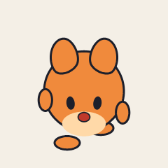

# Três vistas, uma animação

**Situação:** proposta de 23/11/2026; no mesmo dia, as diagonais entraram como possibilidade. Nada implementado. Esperando você decidir os pontos de [o que falta decidir](#o-que-falta-decidir).

**Origem:** a sua pergunta de 23/11/2026. Num jogo 2D visto de cima, tipo Zelda, o personagem precisa de quatro direções (baixo, cima, direita e esquerda). Desenhar cada uma já é trabalho; animar cada uma (andar, atacar, parado) multiplica o trabalho por três. A ideia: você desenha o personagem de frente, de lado e de costas, e o Weasel monta com isso um boneco "em 3D", que você anima uma vez só.

Na maior parte do tempo, são as quatro direções. As diagonais ficam como **possibilidade**, para quando você desenhar uma vista de 3/4 ([vistas na diagonal](#vistas-na-diagonal-opcional)); sem ela, nada muda.

**Weasel:** a linguagem, a exportação e o editor. **Jogo:** nada muda. Saem as mesmas animações de hoje (`walk_down`, `walk_right`, `walk_up` e o `_left` espelhado), e o `tocar("walk", velocity)` escolhe a direção.

## O problema, com o furão

O [furao.weasel](../../exemplos/furao.weasel) já é um personagem de jogo visto de cima, com três vistas (camadas `frente`, `costas` e `lado`, cada uma com `only=`). Para ter três movimentos, ele precisa de:

- **9 animações:** `idle`, `walk` e `attack`, cada uma em `_down`, `_up` e `_right`. O `walk_down` e o `walk_up` são quase iguais; o `walk_right` é outro movimento, escrito à parte.
- **3 ossos para a mesma espada** (`espadaF`, `espadaC` e `espadaL`), porque a espada fica num lugar diferente em cada vista.
- **3 caixas de golpe** (`golpe_down`, `golpe_up` e `golpe_right`), uma por direção, posicionadas à mão.

E um defeito que não aparece: os ossos têm um pivô só, o da frente. Na vista de lado, o braço (`bracoL`, em x=94) gira em volta do pivô da frente (`bracoD`, em x=102).

Com este plano, o furão teria **3 animações**, **um osso de espada** e **uma caixa de golpe** presa a ele.

## O que o Weasel já tem

- **Vistas no mesmo arquivo:** camadas com `only=`, como no furão. O `pose` mostra a frente no desenho parado.
- **Direções no nome da animação:** `_down`, `_up`, `_right`, `_left` e as diagonais. As transições, o `trocar()` e o `tocar()` já entendem esses nomes; a exportação para o Godot cria o `_left` espelhado (`--no-mirror` desliga), e também as diagonais da esquerda.
- **As diagonais no `tocar()`** ([godot.js](../../js/godot.js), `nome_com_direcao`): com as duas (`_down_right` e `_up_right`), ele divide o círculo em 8 fatias. Com só a de baixo, andando para cima na diagonal ele cai na direção reta mais perto: 6 direções, sem mudar nada no Godot.
- **Caixas e pontos presos a ossos:** `box … bone=` e `point … bone=` seguem o osso, inclusive girando junto.
- **Casar peças de duas vistas pelo nome, pelo osso, pela cor e pela distância:** é o que a virada (`anim … turn`, 1.45.0) faz para achar o par de cada peça (`corpo` e `corpoL`). Este plano reaproveita esse casamento.
- **2.5D:** `z=`, `yaw=` e `pitch=` em ossos e formas, `round=`, `billboard` e `zsort` ([capítulo 14](../guia/14-profundidade.md)).
- **Assar no Godot:** com `rig=bones`, o `ik` já sai como poses prontas, quadro a quadro.

## O teste de 23/11/2026

Antes do plano, um bichinho desenhado **só de frente** foi montado com o 2.5D de hoje: cada peça com um `z=` e o corpo girando com `corpo.yaw`.


- **Peças que giram como cartas** (sem `billboard`): de lado, viram riscos. Não serve.
- **Peças que só mudam de lugar** (`billboard`): a frente, o lado e as costas saem sozinhos; o braço de longe some atrás do corpo, o rabo aparece de costas. Mas de lado a barriga sai do contorno e o olho fica na borda.
- **Olhos e barriga colados na bola** (`round=`): de lado, o olho vira um fiapo e a barriga some. É a geometria certa, mas desenho animado trapaceia no perfil.

**A lição:** a posição das peças pode vir do 3D, mas o **desenho** de cada vista tem que ser o seu. Daí as três vistas.

Depois, o passo foi animado uma vez, com o pé indo para a frente no `z`, e visto com a câmera de cima:




- Com a câmera na altura do bicho, o passo de frente só **quica no lugar**.
- Com a câmera de cima, o pé que vai para a frente **desce na tela**, e o passo lê como andar na sua direção.
- O teste girou a câmera (`pitch=-30` na camada), o que também achata a altura, e as orelhas passaram para a frente da cabeça (o `billboard` mede a profundidade pela base da peça). Nenhum dos dois acontece no recurso: ele não gira a câmera nem usa o `billboard` (veja [a câmera](#a-câmera-do-jogo) e [quem fica na frente](#quem-fica-na-frente)).

O arquivo do teste ficou fora do projeto; as imagens estão em `img/`.

## Como funcionaria

### As vistas

Cada camada diz de que vista ela é, no lugar do `only=`:

```weasel
layer frente view=down
layer frente_arma view=down
layer costas view=up
layer lado_tras view=right
layer lado view=right
```

- `view=down` mostra a camada em todas as animações viradas para baixo, e no `pose` (o desenho parado).
- Uma camada sem `view=` aparece em todas as vistas, como hoje uma camada sem `only=`.
- `view=left` é opcional: sem ela, a esquerda sai espelhada, como hoje.
- `view=down_right` e `view=up_right` (3/4 de frente e de costas) também são opcionais: veja [vistas na diagonal](#vistas-na-diagonal-opcional).

### Um esqueleto em 3D

Os ossos continuam os mesmos, com o pivô da frente (x e y). Cada osso ganha uma **profundidade** (o quanto ele está para a frente ou para trás do personagem), e com isso um lugar em 3D.

**De onde vem a profundidade:** da vista de lado. Na vista de lado, o "para a frente" é o x da tela. O Weasel casa as peças de cada osso entre a frente e o lado (como a virada casa `cabeca` com `cabecaL`) e lê o x da peça de lado:

- `cabecaL` está em x=84 e a raiz (`godot root=80,128`) em x=80: a cabeça fica 4 pixels para a frente;
- `peEl` em x=90: o pé esquerdo, 10 para a frente;
- `focinhoL` em x=106 fica de fora da conta: vale a maior peça casada do osso (a cabeça), e não a caixa de todas.

**Quando não dá para ler:**
- um osso sem peça na vista de lado (o braço de longe) usa a profundidade do **par espelhado** na frente: `bracoE` (x=58) usa a de `bracoD` (x=102), porque estão no mesmo y e espelhados em volta da raiz;
- sem par, a do osso pai;
- `side=` no osso corrige: `bone espada parent=corpo pivot=104,108 side=94` diz que, de lado, o osso fica em x=94.

**As costas** não dão profundidade nenhuma: elas dão o desenho de quem olha de trás. Nas costas, a esquerda e a direita trocam de lado na tela. O osso `bracoE` (x=58 na frente) aparece em x=102 de costas, e a peça dele, nas costas, tem que estar lá. No furão de hoje, `bracoEc` está em x=57, do lado errado; num personagem simétrico isso não aparece, mas com o esqueleto em 3D a peça pularia. O Weasel avisa e diz qual osso trocar.

### Cada vista é uma pose 2D comum

Por baixo, nada fica em 3D na hora de desenhar. Em cada quadro, o Weasel:

1. calcula onde cada osso está em 3D (a pose da animação);
2. projeta cada osso na vista (frente, lado ou costas): onde ele cai na tela e para onde aponta;
3. entrega a diferença para a pose parada daquela vista como uma pose 2D comum (`dx`, `dy`, giro), e as peças da vista seguem o osso como hoje.

Por isso:
- as peças continuam desenhos chatos, sem achatar nem entortar;
- tudo o que desenha hoje (luz, estilos de arte, normal map, caixas, pontos) continua funcionando, porque recebe uma pose 2D;
- o defeito do braço do furão some: na vista de lado, o osso gira em volta de onde ele aparece de lado, e não do pivô da frente.

### Animar uma vez

```weasel
# o Weasel gera walk_down, walk_right e walk_up a partir desta
anim walk frames=8 fps=12
key 0 corpo=0,0 peE=0,-5 peE.z=6 peD=0,0 peD.z=-6
key 2 corpo=0,-2 peE=0,0 peE.z=0 peD=0,0 peD.z=0
key 4 corpo=0,0 peE=0,0 peE.z=-6 peD=0,-5 peD.z=6
key 6 corpo=0,-2 peE=0,0 peE.z=0 peD=0,0 peD.z=0
key 8 corpo=0,0 peE=0,-5 peE.z=6 peD=0,0 peD.z=-6
event 0 passo
event 4 passo
```

- **Num arquivo com vistas, uma animação sem direção no nome gera uma por vista:** `walk` vira `walk_down`, `walk_right` e `walk_up` (e o `walk_left`, espelhado, na exportação para o Godot). Os `event`, o `once`, o `fps=` e o `feet=` vão junto.
- **Uma animação escrita à mão com a direção ganha da gerada:** se `attack_up` precisar de algo especial, escreva `anim attack_up`, e só essa sai da sua mão.
- **Os movimentos em 3D:**
  - `osso=dx,dy` anda no plano da frente, como hoje (o `dy` para cima e para baixo vale em todas as vistas);
  - `osso.z=` anda para a frente (positivo) ou para trás;
  - `rot` gira no plano da frente (o braço abrindo para o lado), como hoje;
  - `osso.pitch=` gira para a frente ou para trás (a perna dando o passo, a espada descendo);
  - `osso.yaw=` gira em volta do eixo de pé (a espada varrendo de um lado para o outro).
- De frente, o pé que vai para a frente desce um pouco na tela ([a câmera](#a-câmera-do-jogo)); de lado, ele vai para a direita; de costas, sobe um pouco.

### Peças que inclinam

Uma peça comprida (a espada, uma perna, um braço) tem que inclinar quando o osso aponta para outro lado. Em cada vista, o Weasel gira a peça pelo quanto o osso **parece** ter girado naquela vista:

- a espada descendo para a frente (`espada.pitch=130`): de lado, ela gira 130° na tela; de frente, ela vem na sua direção e **encurta**;
- a mesma espada varrendo (`espada.yaw` de -90 a 90): de frente, passa de um lado para o outro, por baixo do personagem na tela; de lado, vem de trás para a frente; de costas, passa atrás da cabeça.

**Para onde o osso aponta:** para o osso filho, quando há um só. Sem filho (a espada), pela peça mais comprida do osso, na frente e no lado (as duas vistas dão as duas sombras da mesma direção, como a profundidade). `tip=x,y` no osso corrige.

### Quem fica na frente

A ordem de cada vista é a do desenho, como hoje. Durante a animação, uma peça passa para a frente de outra quando o osso dela **cruza** o da outra em profundidade, comparado com a pose parada daquela vista. Assim:

- a ordem que você desenhou (os pés atrás do corpo, as orelhas atrás da cabeça) não muda à toa;
- a espada que desce para a frente passa na frente do corpo de frente e atrás da cabeça de costas, sem `above=` em cada direção.

O `above=` e o `below=` numa `key` continuam valendo e ganham da conta.

### A câmera do jogo

Num jogo tipo Zelda, a tela é quase o chão visto de cima, e os personagens estão de pé nele. O que vai para a frente desce na tela, e a altura não encolhe (os desenhos já estão no ângulo do jogo). Por isso, não é um giro de câmera como no teste, e sim uma conta só:

- **um número para o arquivo inteiro:** o quanto um pixel "para a frente" desce na tela. Com 0.5, a espada 30 pixels à frente do furão virado para baixo aparece 15 pixels abaixo;
- **as três vistas** precisam ser desenhadas no mesmo ângulo (o alto da cabeça aparecendo do mesmo tanto).

### Caixas e pontos

- Uma caixa presa a um osso (`box golpe hit rect … bone=espada only=attack off`) segue o osso em cada vista: anda, gira e encurta com ele. O furão passa de três caixas de golpe para uma.
- Os pontos (`point … bone=`) também: a saída do tiro fica na ponta da arma em cada direção.
- Caixas e pontos sem osso ficam onde foram desenhados, em todas as vistas.

### Vistas na diagonal (opcional)

O normal são as quatro direções. Uma vista de 3/4 é uma possibilidade: sem uma camada `view=down_right` ou `view=up_right`, nada desta seção acontece.

```
up_left (esp.)     up     up_right
left (esp.)         ●     right
down_left (esp.)  down    down_right
```

- **As camadas:** `view=down_right` (3/4 de frente) e `view=up_right` (3/4 de costas). As da esquerda saem espelhadas, como o `_left`. Dá para desenhar só a 3/4 de frente: o `tocar()` usa ela andando para baixo na diagonal e, para cima na diagonal, a direção reta mais perto (6 direções).
- **As animações geradas:** com as duas diagonais, `walk` gera 5 (`walk_down`, `walk_down_right`, `walk_right`, `walk_up_right` e `walk_up`), e o Godot completa as 8 com os espelhos. Hoje, um personagem de 8 direções precisa de 5 animações escritas para cada movimento.
- **A conta:** nas vistas retas, é só trocar os eixos (de lado, o "para a frente" vira o x da tela). Na diagonal, o esqueleto gira até o ângulo da vista, e o x da tela mistura o lado e a profundidade. As peças que inclinam, a ordem que troca, as caixas e os pontos já funcionam em qualquer ângulo: nada muda neles.
- **O ângulo que você desenhou:** uma 3/4 feita à mão quase nunca tem 45° exatos; muita gente desenha uns 30–35°. Se o Weasel supuser 45°, os ossos não caem onde as peças estão, e as peças giram em volta do ponto errado (o defeito do braço do furão). Por isso:
  - o lugar de cada osso parado na diagonal é lido do desenho, pelas peças casadas, como a profundidade é lida do lado;
  - o ângulo é **medido**: o que melhor encaixa os ossos (o x da frente e a profundidade do lado) no que a 3/4 mostra;
  - `angle=` na camada corrige: `layer tres_quartos view=down_right angle=35`.
- **A diagonal também dá profundidade:** o braço de longe, que some de lado, aparece na 3/4. Como o x dele vem da frente, a 3/4 dá a profundidade dele sem precisar do par espelhado. Quando o lado e a diagonal discordam, o Weasel avisa: `peE: 10 no lado, 3 na diagonal`.
- **O custo:** a 3/4 é a vista mais difícil de desenhar e a que mais precisa ter as alturas batendo com as outras. São um ou dois desenhos a mais; por animação, nada a mais.

### Em todo lugar

- **Editor, PNG, SVG, GIF, sprite sheet, normal map, estilos de arte:** as animações geradas são animações comuns.
- **Godot por quadros:** as folhas de sempre; `tocar()`, `trocar()` e as transições, sem mudança.
- **Godot com `rig=bones`:** cada quadro sai como a pose 2D daquela vista, assada, como o `ik`. A ordem que troca vira uma pista de `z_index`. A conferir no Godot (o 4.7.2 está instalado).
- **`--info`:** as vistas e as camadas de cada uma; a profundidade de cada osso e de onde ela veio (`corpo -2 (lado) · peE 10 (lado) · bracoE 14 (par de bracoD) · espada 14 (side=)`); o ângulo de cada diagonal (`down_right: 34°, medido`); as animações geradas.
- **Avisos:**
  - um osso com a peça em alturas muito diferentes na frente e no lado (vistas desalinhadas);
  - nas costas, uma peça do lado trocado (perto do osso espelhado);
  - `view=` e `only=` na mesma camada;
  - um osso sem peça casada no lado e sem par espelhado (a profundidade foi a do pai);
  - o lado e uma diagonal dando profundidades diferentes para o mesmo osso.

### No editor

- **Ao lado da lista de animações, quatro botões de direção** (↓ → ↑ ←), ou oito num arquivo com diagonais. A lista mostra `walk`; os botões escolhem a vista mostrada. A linha do tempo edita as `key` do `walk`.
- **Testar ossos:** os campos `z`, `pitch` e `yaw` num arquivo com vistas. Na vista de lado, arrastar a bolinha do osso para a frente ou para trás muda a profundidade no teste; **Escrever como `key`** grava `osso.z=`.
- **A profundidade de cada osso:** na vista de lado, com o Prender, arrastar a bolinha do osso na horizontal escreve o `side=` dele. Um duplo clique apaga o `side=` e volta à profundidade lida das peças.

## O que fica de fora

- **Diagonais sem desenho:** sem uma 3/4 desenhada, o desenho de cada peça a 45° teria que vir do morph entre a peça de frente e a de lado. Fica melhor que o morph do personagem inteiro, mas o rosto a 45° nunca fica tão bom quanto um desenhado. Fica para depois, se fizer falta. As diagonais **desenhadas** estão no plano ([vistas na diagonal](#vistas-na-diagonal-opcional)).
- **Virar de uma direção para outra** com o 3D (girar o esqueleto em vez do morph da virada): a virada de hoje continua; fica para depois. Com uma 3/4 desenhada, a virada de frente para o lado poderia passar por ela, em vez de derreter as formas no meio.
- **Gerar uma vista que você não desenhou:** as três vistas continuam suas. O que vem de graça é a animação.
- **Personagens de proporção realista:** funcionam, mas dependem muito das peças que inclinam. O alvo é o tamanho de Zelda: cabeça grande, braços e pernas curtos.
- **Uma peça que muda de desenho no meio da animação** (a mão abrindo) continua precisando de um desenho por vista, com `.shape=` ou `show`, como hoje.

## O que falta decidir

Em cada item, **(R)** é a minha recomendação.

1. **Como dizer a vista de uma camada.**
   - **(R)** `view=down|up|right|left` na camada, no lugar do `only=`.
   - Uma linha só com as camadas de cada vista (`views down=frente,frente_arma up=costas …`). Fica tudo num lugar, mas a linha fica longa e repete os nomes.
2. **Como pedir as animações geradas.**
   - **(R)** Sozinho: num arquivo com `view=`, toda animação sem direção no nome gera uma por vista; uma escrita à mão com a direção ganha.
   - Com uma palavra no `anim` (`anim walk views`). Mais explícito, uma palavra a mais em cada animação.
3. **A profundidade dos ossos.**
   - **(R)** Lida da vista de lado (a maior peça casada do osso), com o par espelhado e o pai quando faltar, e `side=` para corrigir.
   - Sempre escrita à mão (`z=` no osso). Nada adivinhado, mas é o trabalho que este plano quer tirar.
4. **O número da câmera.**
   - O nome: `tilt=30` (o ângulo da câmera, em graus: desce `sin(30°)` = 0.5) ou um fator direto (`0.5`). **(R)** em graus, que é como se pensa numa câmera; o nome precisa não bater com outra palavra do Weasel.
   - Onde: **(R)** numa linha nova do arquivo, `views tilt=30`, que também é o lugar de futuras opções das vistas. Sem a linha, 30°.
5. **`pitch=` e `yaw=` nos ossos de um arquivo com vistas.**
   - **(R)** Os mesmos nomes do 2.5D: o osso gira do mesmo jeito; só o desenho das peças muda (elas inclinam por vista, em vez de girar como cartas).
   - Nomes novos, para não haver dois sentidos para a mesma palavra.
6. **Peças compridas encurtam?**
   - **(R)** Sim, até no mínimo 40% do tamanho, para a espada vindo na sua direção não sumir.
   - Não: só giram. Mais simples, mas a espada apontada para a câmera fica comprida demais.
7. **O exemplo.**
   - **(R)** Um furão novo (`exemplos/furao3d.weasel`), com as mesmas vistas e 3 animações. O `furao.weasel` de hoje fica como está: o guia e os testes usam ele.
   - Converter o `furao.weasel`.
8. **O ângulo de uma vista diagonal** (só quando houver uma).
   - **(R)** Medido do desenho, com `angle=` para corrigir.
   - Sempre 45°. Mais simples, mas uma 3/4 desenhada mais fechada (30–35°) faz as peças girarem em volta do ponto errado.
   - Sempre escrito à mão (`angle=` obrigatório). Nada adivinhado, mas você precisa saber o ângulo do seu desenho.

## Etapas

Cada etapa só começa com o seu "pode fazer", e as imagens vão junto com cada decisão que muda o desenho.

- **Etapa 0, o protótipo (fora do projeto):** o furão das três vistas, com `walk` e `attack` escritos uma vez, montado por um script no scratchpad. Ele confere a profundidade lida do lado, o avanço da câmera, a ordem e a espada inclinando. Você vê as folhas das três direções lado a lado com as de hoje antes de a sintaxe ficar fixa. A diagonal entra só para conferir a conta: uma 3/4 do bichinho do teste, gerada a 35°, tem que sair medida como 35°.
- **Etapa 1a, as vistas e os movimentos:** `view=`, a linha `views`, a profundidade dos ossos (`side=`), as animações geradas, `osso=dx,dy` e `osso.z=` em 3D, a câmera, a ordem que troca, caixas e pontos, `--info` e os avisos. Dá conta do `idle` e do `walk`. A conta já sai para qualquer ângulo, então `view=down_right` e `view=up_right`, com o ângulo medido e `angle=`, entram aqui também; sem uma vista diagonal, nada disso aparece. Guia, exemplo e caso de teste.
- **Etapa 1b, os giros:** `rot`, `pitch` e `yaw` em 3D, as peças que inclinam e encurtam, `tip=`, e o Godot com `rig=bones` conferido no Godot. Dá conta do `attack`.
- **Etapa 2, o editor:** os botões de direção no player (quatro, ou oito com diagonais), a linha do tempo da animação base, o Testar ossos com `z`, `pitch` e `yaw`, e arrastar a profundidade no Prender.

**Para o que existe:** tudo depende de `view=`. Sem ele, nada muda, e os desenhos dos testes (`npm test`) ficam iguais, byte a byte.
